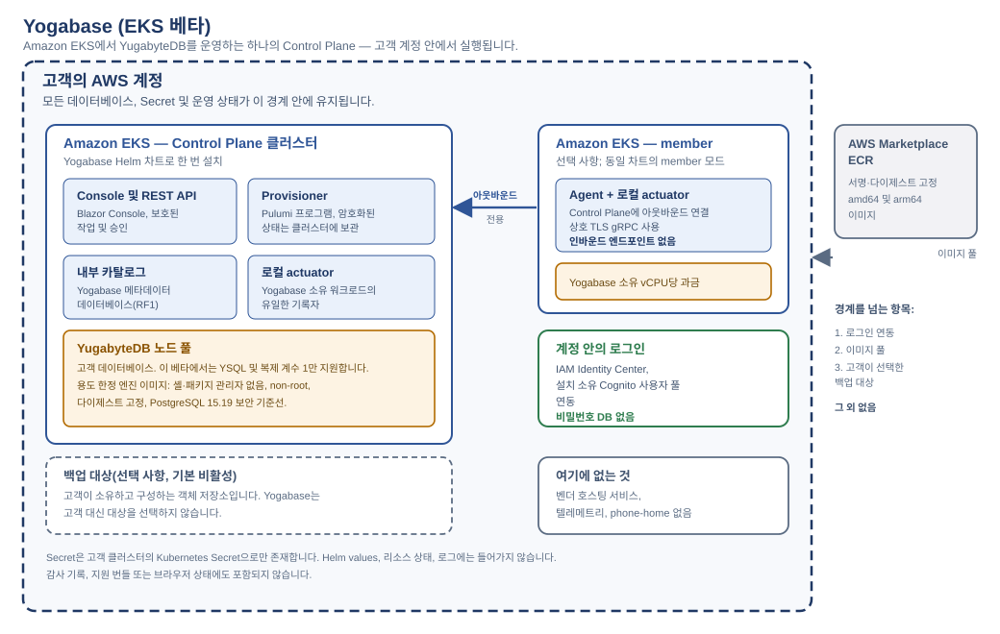
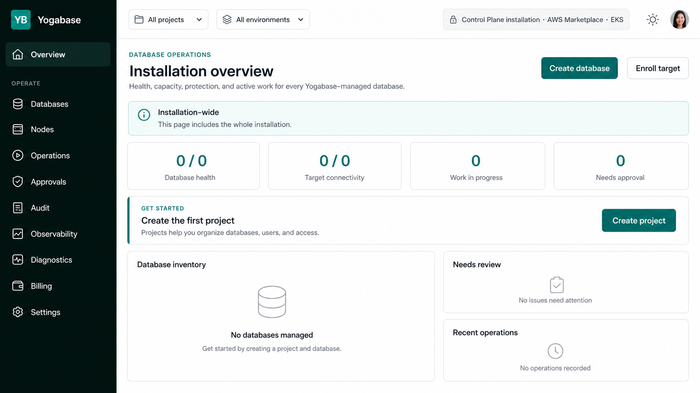
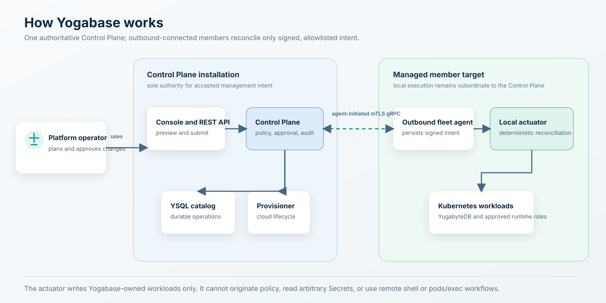
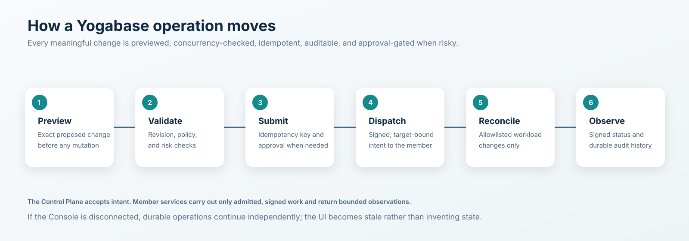
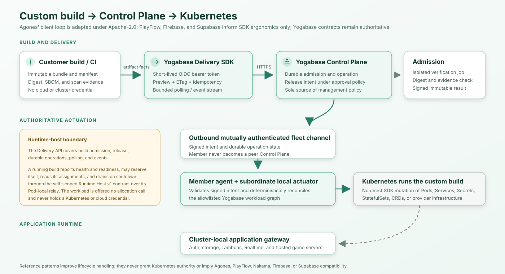

# Yogabase SDKs

한국어 | [English](README.md)

**Yogabase** 기반 애플리케이션을 위한 클라이언트 SDK 프리뷰입니다.

Yogabase는 Kubernetes 전반에서 데이터 서비스를 운영하기 위한 .NET 10 Control Plane입니다. 이 저장소는 비공개 Yogabase 제품 저장소, Helm 차트, 이미지, Control Plane 및 Marketplace 전달 그래프와 의도적으로 분리되어 있습니다. 이곳에는 애플리케이션용 및 워크로드 전달용 클라이언트 라이브러리와 계약 픽스처가 있으며, Kubernetes 오퍼레이터, 클라우드 프로비저닝 도구 또는 범용 관리 SDK가 아닙니다.

> **프리뷰 상태:** 이 저장소의 패키지는 아직 게시되지 않은 프리뷰입니다. 로컬 빌드가 성공하더라도 NuGet, npm, PyPI, Maven Central, pub.dev, GitHub Packages 또는 다른 레지스트리에 게시할 권한이 부여되는 것은 아닙니다.

## Yogabase가 하는 일

Yogabase는 팀이 Kubernetes에서 데이터 서비스를 계획, 승인, 배포, 관찰 및 운영할 수 있는 하나의 권위 있는 위치를 제공합니다. 첫 제품 범위는 **Yogabase Core**입니다. 여기에는 관리형 YugabyteDB 수명 주기, 지원되는 데이터베이스 API인 **YSQL**, Blazor Console, 중앙 Control Plane, 그리고 AWS, Azure, Google Cloud, Oracle Cloud 적격성 프로필에 이식 가능한 Kubernetes 프로비저닝이 포함됩니다.

Yogabase는 하나의 Helm 차트와 하나의 조정된 이미지 제품군으로 제공되는 단일 Kubernetes Marketplace 제품입니다. 차트에는 두 가지 설치 모드가 있습니다.

| 모드 | 역할 |
|---|---|
| `control-plane` | 권위 있는 Control Plane, Console, REST API, fleet gateway, 프로비저닝 워크플로, 청구/계량, 로컬 actuator/agent 및 전용 RF1 YSQL 카탈로그를 실행합니다. |
| `member` | 각 관리 대상에 설치되는 경량 서비스를 실행합니다. 즉, 아웃바운드 fleet agent와 결정론적 로컬 actuator입니다. |

Control Plane은 Yogabase에서 허용된 관리 의도의 유일한 출처입니다. member는 인바운드 관리 API를 노출하지 않고, 제품 정책을 결정하지 않으며, 동등한 Control Plane이 되지 않습니다. member는 상호 TLS 인증을 사용하는 gRPC로 Control Plane에 **아웃바운드** 연결하고, 서명된 대상 바인딩 의도를 지속하며, Control Plane을 사용할 수 없을 때에도 이미 수락된 로컬 작업을 계속 조정합니다.

## Marketplace 아키텍처



EKS Beta 아키텍처에서는 데이터베이스, Secret 및 운영 상태가 고객의 AWS 계정 안에 유지됩니다. member는 권위 있는 Control Plane에 아웃바운드로만 연결하며, 고객은 선택적 백업 대상의 제어권을 유지합니다.

## Console 경험



_이 이미지는 소스에 근거한 Console 개념도이며 실제 환경이나 상태 화면이 아닙니다. 빈 상태를 의도적으로 사용하며 고객 데이터, 지표 또는 활성화된 기능을 나타내지 않습니다._

## 아키텍처 작동 방식



로컬 actuator는 의도적으로 종속적입니다. Yogabase 소유 Kubernetes 워크로드를 쓰는 유일한 구성 요소이지만, Control Plane이 서명하고 허용 목록에 올린 의도만을 결정론적 리소스로 변환할 수 있습니다. 임의의 Secret을 읽거나 Pod에서 명령을 실행하거나 관리 정책을 생성하지 않습니다.

### 클라우드 및 대상 ID

클라우드 공급자 선택은 Console 드롭다운이나 클라이언트 API 매개변수가 아니라 설치 ID입니다. Marketplace 릴리스가 Control Plane 공급자를 고정합니다. 각 member의 공급자와 관리 클러스터 종류는 등록 시 증명되며 변경할 수 없는 대상 ID가 됩니다. 프로비저닝은 .NET `ICloudProvisioner` 경계 뒤에 남고 Pulumi .NET 프로그램을 사용하지만, 제품은 하나의 공급자 중립 Control Plane과 하나의 Helm 차트를 유지합니다.

### 데이터베이스 작업

Core는 선택된 Kubernetes 대상에서 논리적 YugabyteDB 데이터베이스 서비스를 관리합니다. YSQL 우선 데이터베이스 수명 주기, 상태/토폴로지 가시성, 명시적 RF1/RF3/RF5 토폴로지 선택, 보호된 scale-out, 컴퓨트 크기 조정, 스토리지 확장, 선택적 논리 암호화 백업, 새 대상 또는 비어 있는 대상에 대한 복원, 허용 목록 기반 패치 업그레이드, 안전한 삭제, 유지된 PVC, 진단 및 민감 정보가 제거된 지원 번들을 지원합니다.

모든 변경은 내구성 있는 작업으로 설계됩니다.

1. Yogabase가 요청한 정확한 변경의 미리보기를 생성합니다.
2. 요청은 현재 리소스 revision 및 idempotency key와 대조하여 검사됩니다.
3. 위험한 작업에는 적절한 승인이 필요합니다.
4. 수락된 작업은 감사 가능하고 복구 가능하며, 꾸며 낸 상태가 아닌 제한된 관찰 사실을 보고합니다.

Yogabase는 임의 SQL, 엔진 내부 토폴로지를 클라이언트 계약으로 노출하거나, 원격 셸 접근, `pods/exec` 워크플로, peer gossip 또는 대체 Control Plane을 제공하지 않습니다. YCQL, 자동 scale-in, PITR, 다운그레이드, 교차 클러스터 데이터베이스 배포는 현재 Core 범위 밖입니다.

### 작업 중 일어나는 일



### 보안 경계

YSQL 트래픽은 인증서 기반이며 fail-closed입니다. 노드 간 및 클라이언트-서버 TLS가 필수이고, 클라이언트 인증서 ID는 명시적으로 허용 목록에 등록됩니다. Secret 값은 브라우저 상태, 리소스 상태, 로그, 감사 기록, Pulumi 출력 또는 지원 번들에 속하지 않습니다.

제품은 공개 Kubernetes API를 의도적으로 작게 유지합니다. `YogaDatabase`, `YogaDatabaseOperation`, `YogaApplicationRuntime`, `YogaValkey`, `YogaRobustMQCluster`입니다. 이 리소스는 Control Plane의 대체물이 아니라, 서명된 desired-state 입력과 제한된 로컬 관찰입니다.

### Direct 및 GitOps 사용

Yogabase를 통한 Direct 운영이 권위 있습니다. GitOps 지원은 고객의 자체 로컬 Git 워크플로를 위해 결정론적 YAML과 diff를 내보냅니다. Yogabase는 브랜치를 push하거나 pull request를 만들거나 고객 저장소에 쓰지 않습니다.

## 커스텀 빌드 전달과 Kubernetes



커스텀 빌드 워크플로는 Kubernetes 또는 클라우드 자격 증명을 받지 않고 권위 있는
Control Plane을 통해 Kubernetes에 도달합니다. 별도로 구성하는 Delivery 클라이언트는
수명이 짧은 워크로드 OIDC 토큰으로 TLS 전용 `/api/v1/delivery` 호스트를 호출합니다.
승인된 템플릿 조회, 환경 및 변경 불가능한 아티팩트 admission의 preview/submit, release,
promotion, rollback, 환경 decommission을 수행하고, 제한된 polling 또는 SSE로 내구성 있는
작업을 추적할 수 있습니다.

아티팩트 제출에는 자격 증명이 없는 공급자 네이티브 locator와 bundle, manifest, SBOM,
scan evidence의 정확한 digest만 포함됩니다. Control Plane은 의도를 기록하고, 격리된
admission Job이 아티팩트를 검증합니다. 이후 서명된 의도가 아웃바운드 상호 TLS fleet
채널을 통해 member의 종속 로컬 actuator로 전달되며, 이 actuator만 Kubernetes 워크로드를
조정합니다.

이제 서버는 실행 중인 빌드가 health/readiness를 보고하고 reservation/allocation을 받으며
shutdown 시 drain할 수 있는 버전이 지정된 runtime-host 계약을 제공합니다
(`contracts/yogabase-runtime-host-v1.openapi.json`). `Yogabase.Yogabase.RuntimeHost` 패키지는
Apache-2.0에 따라 Agones의 클라이언트 루프 형태를 충실히 변형한 C# 파생물로 그 워크로드
측을 구현합니다. 자세한 내용은 [`docs/REFERENCE_REVIEW.md`](docs/REFERENCE_REVIEW.md) 및
[`docs/UNITY_DEDICATED_SERVER.md`](docs/UNITY_DEDICATED_SERVER.md)를 참조하세요. PlayFlow,
Nakama, Firebase 및 Supabase는 클라이언트 수명 주기, 세션, 취소, polling, event stream 및
플랫폼 사용성을 개선하기 위한 참고 자료로만 남습니다.

## 애플리케이션 런타임 및 SDK 경계

Yogabase는 승인된 애플리케이션 작업을 위한 대상 로컬 애플리케이션 게이트웨이를 노출할 수 있습니다. 이 SDK가 구현하는 경계는 다음과 같습니다.

- Bootstrap은 Secret이 아닌 프로젝트 바인딩 REST, ID 및 별도 배포된 realtime 엔드포인트 구성을 반환합니다.
- 인증은 회원가입, 로그인/로그아웃, 이메일 확인, 비밀번호 재설정, MFA 및 복구 코드, 외부 ID 콜백과 함께 PKCE authorization code 및 순환 refresh token을 지원합니다. SDK에는 기밀 클라이언트 자격 증명이 포함되지 않습니다.
- **클라이언트 측 데이터 표면은 없습니다.** Data API 모듈은 철회되었습니다(소유자 결정, 2026-09-08). 애플리케이션은 서버 측에서 전체 접근 권한의 데이터베이스 컨텍스트로 실행되는 Lambda, 그리고 Auth, Storage, Realtime을 통해서만 프로젝트 데이터에 접근합니다.
- 스토리지는 매개되며 digest 및 idempotency에 바인딩되고, 공급자 자격 증명이나 서명된 URL을 반환하지 않습니다.
- Stateless Functions는 제한된 공개 계약으로 정확히 등록된 버전을 호출합니다.
- Actor Lambdas는 버전이 지정된 프로젝트 로컬 인스턴스 하나를 대상으로 하며, Workflow Lambdas는 변경 불가능한 정의 버전 하나를 시작하고 v1 cancel 작업만 노출합니다.
- Realtime은 별도로 반환된 SignalR origin을 사용하여 topic subscribe/unsubscribe, 서명된 Lambda binding 호출, `eventId`로 중복 제거되는 at-least-once 완료 이벤트를 제공합니다. 작성된 .NET 클라이언트는 이 흐름을 직접 구현하며 JSON이 기본 Hub 프로토콜입니다.

클라이언트는 공급자 중립적이고 shard를 인식하지 않습니다. 클라우드 선택기, 클라우드 자격 증명, Kubernetes ID, TServer 주소, tablet/shard 식별자, shard key, 물리적 배치 맵 또는 토폴로지 생성을 받지 않습니다. YugabyteDB가 내부 라우팅과 배치를 소유합니다. Yogabase는 또 다른 데이터 경로 라우터를 도입하지 않고 제한된 상태 및 용량 사실을 관찰합니다.

SDK는 범용 사용자용 Control Plane 관리 API, 인프라 프로비저닝, fleet 명령, Kubernetes CRD, 승인 변경, 원격 셸, `pods/exec`, 일반 알림, 분석, GameSessions 및 공급자 자격 증명을 의도적으로 제외합니다. 유일한 Control Plane 표면은 위에서 설명한 정확한 워크로드 인증 Delivery v1 계약과, 호스팅된 워크로드가 loopback으로 접근하는 self-scoped Runtime Host v1 계약입니다. 후자는 애플리케이션이나 Delivery 자격 증명을 받지 않으며 워크로드에 allocation 호출을 노출하지 않습니다.

## 기능 상태

Yogabase는 서명된 관찰과 릴리스에 고정된 증거를 통해 모듈 및 프로토콜 가용성을 보고합니다. 구성만으로 성공적인 배포로 간주하지 않습니다.

| 영역 | 현재 경계 |
|---|---|
| Core | 주 제품 범위입니다. 내구성 있고 승인 인식적인 워크플로를 통한 관리형 YugabyteDB/YSQL 작업입니다. |
| Extended | Functions, Actor Lambdas, Workflow Lambdas, Dynamic Code, sandboxing 및 Scheduler/Jobs로 범위가 한정됩니다. 각각의 런타임 증거가 적격성을 충족할 때까지 기능은 사용할 수 없습니다. |
| Valkey | Yogabase 소유 C# 조정 경로를 사용합니다. 승격 및 Redis 프로토콜 주장은 실제 적격성 증거에 의해 계속 제한됩니다. |
| RobustMQ | 제한된 Yogabase 소유 C# 수명 주기 포트를 사용합니다. 수명 주기 및 Kafka/AMQP/MQTT 프로토콜 주장은 독립적으로 적격성이 확인될 때까지 사용할 수 없습니다. |

이 README는 제품 아키텍처와 경계를 설명합니다. 비활성화되었거나 증거에 의해 제한된 기능이 현재 사용 가능하다는 약속이 아닙니다.

## 패키지

.NET 이외의 패키지 식별자는 연속성을 위해 기존 프리뷰 이름을 유지합니다. 이는 레지스트리 게시나 지원 약속을 의미하지 않습니다. 버전 `0.3`은 기존 애플리케이션 계약을 유지하면서 워크로드 인증 Control Plane Delivery v1 표면과 교차 플랫폼 수명 주기 개선을 추가합니다.

| 플랫폼 | 위치 | 현재 패키지 ID | 적격성 |
|---|---|---|---|
| .NET | `src/dotnet/Yogabase.Yogabase.Client` | `Yogabase.Yogabase.Client` `0.3.0-preview.1` | 작성된 애플리케이션, PKCE, SignalR, Delivery, 게임 서버 및 빌드 클라이언트; `netstandard2.1` 및 `net10.0` |
| TypeScript | `languages/typescript` | `@stackyoga/yogabase-client-preview` `0.3.0-preview.1` | 생성된 애플리케이션 클라이언트와 작성된 Delivery/storage-key facade |
| Python | `languages/python` | `stackyoga-yogabase-client-preview` `0.3.0.dev1` | 생성된 애플리케이션 클라이언트와 작성된 비동기 Delivery/storage-key facade |
| Java/JVM | `languages/java` | `io.stackyoga:yogabase-client-preview` `0.3.0-preview.1` | 생성된 애플리케이션/Delivery 클라이언트와 작성된 JVM facade; Kotlin/JVM 상호 운용 경로 |
| Dart | `languages/dart` | `stackyoga_yogabase_client_preview` `0.3.0-dev.1` | 실험적 생성 애플리케이션/Delivery 소스와 작성된 facade |
| .NET Lambda 컨텍스트 | `src/dotnet/Yogabase.Lambda` | `Yogabase.Lambda` `0.1.0-preview.1` | Lambda 번들을 위한 작성된 런타임 컨텍스트 래퍼; `netstandard2.1` 및 `net10.0`(데이터베이스 핸들은 `net10.0`에만 존재); fake provider 테스트만 있으며 실제 설치 증거 없음 |
| .NET runtime host | `src/dotnet/Yogabase.Yogabase.RuntimeHost` | `Yogabase.Yogabase.RuntimeHost` `0.1.0-preview.1` | 작성된 self-scoped runtime-host 클라이언트; `netstandard2.1` 및 `net10.0`; fake transport 테스트만 있으며 live-gateway 증거 없음 |
| Unity | `languages/unity/com.stackyoga.yogabase-runtime-host` | `com.stackyoga.yogabase-runtime-host` `0.2.1-preview.1` | runtime-host 모듈, `link.xml`, Editor 게시 흐름(`Yogabase ▸ Publish Server`)을 담은 UPM 패키지; Editor 스크립트는 실제 Unity 6000.5.7f1 참조 어셈블리 세트에 대해 C# 9로 컴파일 검증되었으나, Editor에서 창을 실행한 적도 IL2CPP 빌드로 runtime 모듈을 검증한 적도 없음 |

변경 불가능한 애플리케이션 스냅샷은 `contracts/yogabase-client-v1.openapi.json`이며 SHA-256은 `e1fe951a95e2da44efffbd4b4dc2985aa8ca09118d89a5360a1eebddb04d8582`입니다. 이 스냅샷은 플레이어 대상 `/v1/servers/*` 게임 서버 표면을 포함하므로 모든 언어에서 생성됩니다. 빌드 수집 스냅샷은 `contracts/yogabase-builds-v1.openapi.json`이며 SHA-256은 `8b2aa93166f0f0990c78c1983ee9bb54b7d6dbb10748da504b572c0d9a63efd6`입니다. 이는 프로젝트 범위의 `ybt_` 개발자 토큰으로 접근하는 개발자 도구 표면으로, .NET `YogabaseBuildsClient`와 Unity Editor 패키지가 구현하며 다른 언어에서는 의도적으로 생성하지 않습니다. 워크로드 스냅샷은 `contracts/yogabase-delivery-v1.openapi.json`이며 SHA-256은 `1eca152807ed2c6ab834b6ad7fea5fedb514ce359bd8f02f028635b03b8b6cc4`입니다. runtime-host 스냅샷은 `contracts/yogabase-runtime-host-v1.openapi.json`이며 SHA-256은 `e0393d8dd7962a0bf2447fd5a79ee22dbaa3f271f6bb98b92d8e4749365967e7`입니다. 이 문서는 수명 주기 상태와 오류 코드를 위한 서버 측 참조로만 체크인되며 의도적으로 코드 생성을 하지 않습니다. 워크로드는 그 문서가 선언한 instance 주소 경로가 아니라 self-scoped relay 경로를 호출하기 때문입니다. 인접한 checksum, Kiota lock 및 `MANIFEST.json`은 이 저장소를 정확한 계약과 generator에 바인딩합니다.

`contracts/` 아래의 모든 문서는 제품 저장소의 같은 이름 `docs/api/` 파일과 바이트 단위로 동일한 사본이며 `ContractDigestTests`가 이를 검증합니다. 이전의 `contracts/planned/` 문서는 제품이 빌드와 게임 서버 표면을 구현하는 동안 여기에서 작성된 것이었고, 제품이 두 표면을 모두 게시했으므로 조정하지 않고 삭제되었습니다.

## 로컬 검증

```text
dotnet restore Yogabase.SDKs.slnx --locked-mode
dotnet build Yogabase.SDKs.slnx -c Release --no-restore
dotnet test Yogabase.SDKs.slnx -c Release --no-restore --no-build
dotnet pack src/dotnet/Yogabase.Yogabase.Client/Yogabase.Yogabase.Client.csproj -c Release --no-restore

cd languages/typescript && npm ci && npm test
cd languages/python && python -m unittest discover -s tests
cd languages/java && mvn test
cd languages/dart && dart analyze
```

`scripts/regenerate-clients.sh`를 실행하면 세 계약을 모두 검증하고 고정된 Kiota 1.34.1 도구를 복원하여 네 개의 애플리케이션 클라이언트와 Java/Dart Delivery 프로토콜 클라이언트를 다시 만듭니다. runtime-host 계약은 checksum만 검증하며 생성하지 않고, 작성된 runtime-host 모듈은 재생성 대상이 아닙니다. 작성된 Delivery facade는 보존됩니다. 각 생성 언어 폴더는 자체 package manifest, 사용 가능한 경우 dependency lock, Kiota lock, 소스, 문서 및 conformance helper를 유지합니다. 다운로드한 도구, 캐시, 의존성 트리와 빌드 중간 산출물은 제외됩니다. 과거 가져온 아티팩트는 `artifacts/imported` 아래에서 변경하지 않으며 현재 빌드는 `artifacts/local` 아래에 둡니다.

### 자체 호스팅 설치에 클라이언트 연결하기

.NET 클라이언트의 공개 진입점은 `Yogabase.Yogabase.YogabaseClient`입니다. 공개 생성자가 없으며, 호출 측은 정적 `YogabaseClient.CreateAsync(Uri gatewayEndpoint, string publishableKey, YogabaseClientOptions? options = null, CancellationToken cancellationToken = default)` 팩토리 메서드를 통해 이를 생성합니다. `gatewayEndpoint`는 설치본의 애플리케이션 게이트웨이 origin이며, `publishableKey`는 프로젝트의 publishable key입니다.

```csharp
using Yogabase.Yogabase;

await using var yogabase = await YogabaseClient.CreateAsync(
    new Uri("https://<installation-host>"),
    "<publishable-key>");
```

`<installation-host>`와 `<publishable-key>`는 플레이스홀더이며, 이 저장소는 둘 중 어느 것도 정하지 않습니다. 자체 호스팅 설치의 호스트 이름과 해당 프로젝트의 publishable key는 모두 그 설치본의 소유자가 제공합니다. 실제 publishable key는 `sy_pub_`로 시작하며, 그렇지 않은 값은 `CreateAsync`가 거부합니다.

publishable key는 Secret이 아닙니다. 이는 게이트웨이에 프로젝트를 식별시키는 값이며 클라이언트 코드에 포함해도 안전하고, 그 자체로는 아무것도 인증하지 않습니다. 이 키로 가져오는 bootstrap 문서에는 endpoint, 식별자, 기능 사실만 담깁니다. Yogabase는 클라이언트가 대신 보유할 수 있는 권한 있는 대응 키를 발급하지 않습니다. 인증이 필요한 모든 호출은 프로젝트의 OIDC authority에서 받은 사용자별 access token을 사용하므로, 클라이언트는 프로젝트 전체를 대변하는 자격 증명을 결코 포함하지 않습니다.

콘솔 시트는 설치본의 소유자가 제공하는 호스트 이름을 사용해 `https://<installation-host>/console-seat/claim`에서 확보합니다.

## 플랫폼 적격성

생성된 REST 소스만으로 production 플랫폼 통합이 적격해지는 것은 아닙니다. `netstandard2.1` 호환성만으로 Unity 또는 AOT가 적격하다는 뜻도 아닙니다. Dart 패키지는 Dart 3.13.2 분석과 작성 소스 테스트를 통과했지만 Android, Flutter, Kotlin/JVM 런타임 통합, Unity IL2CPP, 네이티브 보안 저장소, interactive cookie 처리, .NET 이외의 SignalR 통합 및 live-gateway conformance는 지원을 주장하기 전에 각각 명시적인 플랫폼 증거가 필요합니다.

runtime-host 모듈과 Unity 패키지는 체크인된 계약을 기준으로 작성되었고 fake transport 단위 테스트로만 검증되었습니다. Unity Editor import, IL2CPP 빌드, 실제 relay 세션으로 실행한 적이 없으며 계열별 runtime-host conformance 배터리(restart, replay, duplicate, stale-epoch, double-allocation, reservation-expiry, disconnect, Pod 교체, drain/shutdown 경합, credential-confusion, secret-negative)도 실행하지 않았습니다. 두 가지 모두 적격성이 검증되지 않은 preview로 취급하세요.
