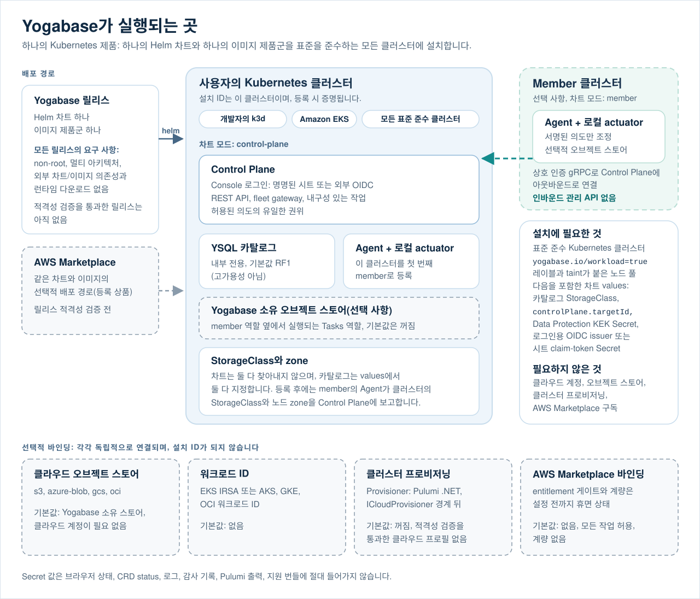
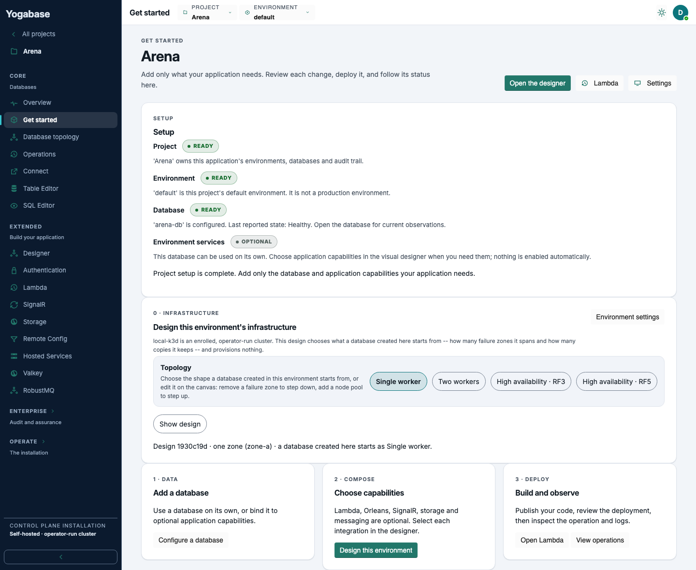
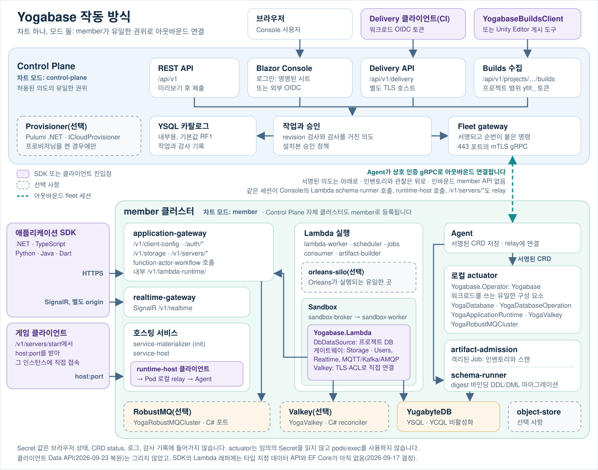
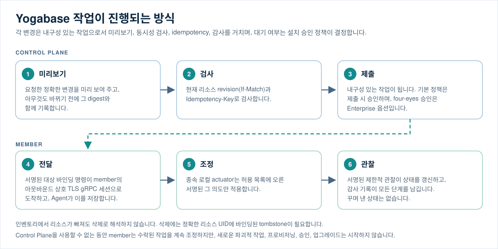
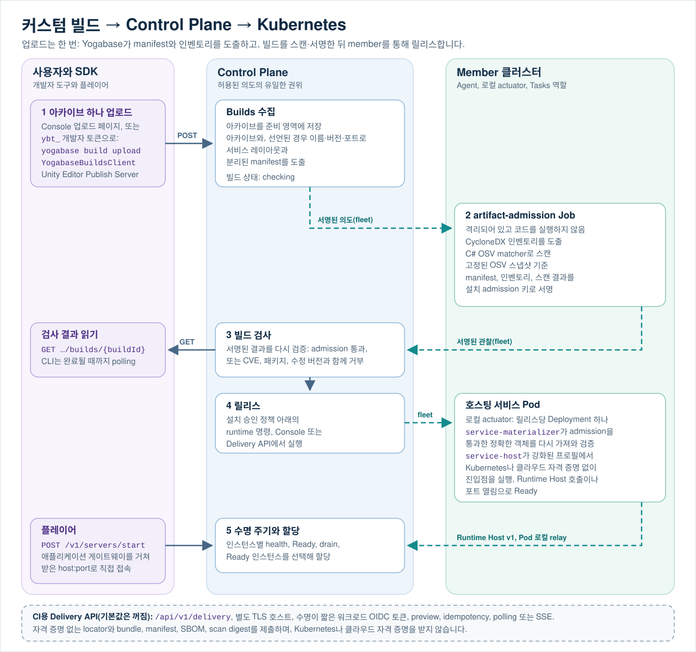

# Yogabase SDKs

한국어 | [English](README.md)

**Yogabase** 기반 애플리케이션을 위한 클라이언트 SDK 프리뷰입니다.

Yogabase는 표준을 준수하는 모든 Kubernetes 클러스터에 설치되어, 애플리케이션 개발자에게 관리형 데이터베이스와 함께 로그인, Lambda, 스토리지, realtime, 호스팅 게임 서버를 제공하는 .NET 10 Control Plane입니다. 이 저장소는 비공개 Yogabase 제품 저장소, Helm 차트, 이미지, Control Plane 및 릴리스 그래프와 의도적으로 분리되어 있으며, 제품에서 가져오는 것은 제품이 게시한 OpenAPI 계약의 바이트 단위로 동일한 사본뿐입니다. 이곳에는 애플리케이션용, 워크로드 전달용, runtime-host용, Lambda 컨텍스트용 클라이언트 라이브러리와 Editor 게시 도구를 갖춘 Unity 패키지, 진단용 샘플, 그리고 이들의 계약 픽스처가 있습니다. Kubernetes 오퍼레이터, 클라우드 프로비저닝 도구 또는 범용 관리 SDK가 아닙니다.

> **프리뷰 상태:** 이 저장소의 패키지는 아직 게시되지 않은 프리뷰입니다. 로컬 빌드가 성공하더라도 NuGet, npm, PyPI, Maven Central, pub.dev, GitHub Packages 또는 다른 레지스트리에 게시할 권한이 부여되는 것은 아닙니다.

## Yogabase가 하는 일

Yogabase는 팀이 Kubernetes에서 데이터베이스와 애플리케이션 백엔드를 생성, 배포, 관찰 및 운영할 수 있는 하나의 권위 있는 위치를 제공합니다. 첫 범위는 **Yogabase Core**입니다. 여기에는 관리형 YugabyteDB 수명 주기, 지원되는 데이터베이스 API인 **YSQL**, Blazor Console, 중앙 Control Plane이 포함되며, 그 주변의 애플리케이션 플랫폼이 로그인, Lambda, 스토리지, realtime, 호스팅 게임 서버를 더합니다. 클러스터 프로비저닝은 AWS, Azure, Google Cloud, Oracle Cloud 프로필을 갖춘 선택적 바인딩이며, 아직 적격성 검증을 통과한 프로필은 없습니다.

Yogabase는 하나의 Helm 차트와 하나의 조정된 이미지 제품군으로 이루어진 단일 Kubernetes 제품이며, 로컬 k3d 클러스터부터 Amazon EKS까지 표준을 준수하는 모든 Kubernetes 클러스터에 설치됩니다. AWS Marketplace 등록 상품은 이 제품의 선택적 배포 경로 중 하나일 뿐 제품의 정체성이 아닙니다. 차트에는 두 가지 설치 모드가 있습니다.

| 모드 | 역할 |
|---|---|
| `control-plane` | 권위 있는 Control Plane, Console, REST API, fleet gateway, 청구, 로컬 actuator/agent 및 전용 YSQL 카탈로그(기본값 RF1)를 실행합니다. Pulumi 프로비저닝 워커는 프로비저닝이 활성화된 경우에만 렌더링되고, Marketplace entitlement와 계량은 AWS Marketplace 바인딩이 구성되지 않는 한 휴면 상태로 남으며, Yogabase 소유 오브젝트 스토어는 선택 사항입니다. |
| `member` | 각 관리 클러스터에 설치되는 경량 서비스를 실행합니다. 즉, 아웃바운드 fleet agent와 결정론적 로컬 actuator이며, 선택적으로 Yogabase 소유 오브젝트 스토어도 실행합니다. |

Control Plane은 Yogabase에서 허용된 관리 의도의 유일한 출처입니다. member는 인바운드 관리 API를 노출하지 않고, 제품 정책을 결정하지 않으며, 동등한 Control Plane이 되지 않습니다. member는 상호 TLS 인증을 사용하는 gRPC로 Control Plane에 **아웃바운드** 연결하고, 서명된 대상 바인딩 의도를 지속하며, Control Plane을 사용할 수 없을 때에도 이미 수락된 로컬 작업을 계속 조정합니다.

## Yogabase가 실행되는 곳



하나의 Yogabase 릴리스, 즉 하나의 Helm 차트와 하나의 이미지 제품군은 개발자의 k3d 클러스터부터 Amazon EKS까지 표준을 준수하는 모든 Kubernetes 클러스터에 설치됩니다. 설치본은 자신이 실행되는 클러스터로 식별되며, 이 ID는 등록 시 증명됩니다. Control Plane이 설치된 클러스터는 스스로를 첫 번째 member로 등록하고, 다른 클러스터는 같은 차트를 `member` 모드로 설치해 아웃바운드로 연결합니다. 클라우드 오브젝트 스토어, 워크로드 ID, 클러스터 프로비저닝, AWS Marketplace entitlement는 각각 독립적으로 연결되는 선택적 바인딩입니다. 어느 것도 설치 ID가 아니며, 설치에는 이 중 어느 것도 필요하지 않습니다. 다만 설치에는 `yogabase.io/workload=true` 레이블과 taint가 붙은 노드 풀과 차트 values가 필요하며, 여기에는 카탈로그의 StorageClass, `controlPlane.targetId`, Data Protection 키 암호화 키를 담은 Secret, 그리고 OIDC issuer 또는 시트 claim token을 담은 Secret을 통한 Console 로그인이 포함됩니다. 차트는 StorageClass와 노드 zone을 찾아내지 않으므로 카탈로그는 values에서 둘 다 지정하며, 클러스터가 등록된 뒤에는 member의 Agent가 클러스터의 StorageClass와 노드 zone을 Control Plane에 보고합니다. AWS Marketplace 등록 상품은 같은 차트와 이미지의 선택적 배포 경로 중 하나이고, 해당 바인딩이 구성되지 않는 한 entitlement 게이트와 계량은 휴면 상태로 남습니다. 이 배포 경로는 아직 릴리스 적격성 검증을 통과하지 않았습니다.

## Console 경험



_Console의 Get started 페이지를 실제로 캡처한 이미지입니다. 2026-09-22에 제품 자체의 브라우저 테스트 하네스에서 1440 px 너비의 라이트 모드로, 데모 데이터(프로젝트 "Arena", 등록된 로컬 클러스터에 있는 그 기본 환경, 하네스가 정상으로 표시한 데이터베이스)를 사용해 촬영했으며, 고객 설치본이나 실시간 상태가 아닙니다. 제품 저장소는 일반 테스트 스위트에서는 실행되지 않는 명시적 캡처 테스트(`ReadmeCaptureBrowserTests`)로 이 이미지를 다시 만들 수 있으며, 연속 두 번 실행한 결과 파일이 동일했습니다. 개발자는 로그인한 뒤 이 화면에서 시작합니다. 설정 상태, 환경의 인프라 설계, 그리고 Data, Compose, Deploy 단계가 이어집니다. 왼쪽 메뉴는 Console을 Core, Extended, Enterprise, Operate로 묶으며, Enterprise와 Operate는 처음에 접혀 있습니다._

## 아키텍처 작동 방식



승인은 설치본의 승인 정책을 따르며(기본값은 제출 시 승인), Provisioner는 선택적 프로비저닝 바인딩이 활성화된 경우에만 존재합니다.

로컬 actuator는 의도적으로 종속적입니다. Yogabase 소유 Kubernetes 워크로드를 쓰는 유일한 구성 요소이지만, Control Plane이 서명하고 허용 목록에 올린 의도만을 결정론적 리소스로 변환할 수 있습니다. 임의의 Secret을 읽거나 Pod에서 명령을 실행하거나 관리 정책을 생성하지 않습니다.

### 클라우드 및 대상 ID

설치 ID는 Yogabase가 설치된 Kubernetes 클러스터이며 등록 시 증명됩니다. Console 드롭다운이나 클라이언트 API 매개변수가 아닙니다. 클라우드 오브젝트 스토어, 워크로드 ID, 클러스터 프로비저닝은 각각 독립적으로 연결되는 선택적 바인딩이며, 클라우드 공급자는 그런 바인딩의 공급업체를 가리킬 뿐 설치본을 가리키지 않습니다. 각 member의 클러스터 ID는 등록 시 증명됩니다. 프로비저닝을 사용할 때는 Pulumi .NET 프로그램과 함께 .NET `ICloudProvisioner` 경계 뒤에 유지됩니다. Yogabase를 설치하거나 운영하는 데 프로비저닝이 필요하지는 않으며, 제품은 하나의 공급자 중립 Control Plane과 하나의 Helm 차트를 유지합니다.

Console 로그인은 설치본이 명명된 Console 시트와 외부 OIDC 공급자 중에서 선택하며, 선택적으로 AWS IAM Identity Center 사전 설정을 사용할 수 있습니다. Console ID는 애플리케이션 호출이나 SDK 호출을 인증하지 않습니다.

### 데이터베이스 작업

Core는 선택된 Kubernetes 클러스터에서 논리적 YugabyteDB 데이터베이스 서비스를 관리합니다. YSQL 우선 데이터베이스 수명 주기, 상태/토폴로지 가시성, 명시적 RF1/RF3/RF5 토폴로지 선택, 보호된 scale-out, 컴퓨트 크기 조정, 스토리지 확장, 허용 목록 기반 패치 업그레이드, 안전한 삭제, 유지된 PVC, 진단 및 민감 정보가 제거된 지원 번들을 지원합니다. Console은 각 데이터베이스에서 논리 암호화 백업과, 새 대상 또는 비어 있는 대상으로의 복원도 내구성 있는 작업으로 제공하지만, 둘 다 아직 실제 환경 적격성 검증을 통과하지 않았습니다.

모든 변경은 내구성 있는 작업으로 설계됩니다.

1. Yogabase가 요청한 정확한 변경의 미리보기를 생성합니다.
2. 요청은 현재 리소스 revision 및 idempotency key와 대조하여 검사됩니다.
3. 변경이 대기해야 하는지는 설치본의 승인 정책이 결정합니다. 기본 제공 정책은 제출 시 설치 정책으로 승인하며, 독립(four-eyes) 승인은 Enterprise 계층에서 선택하는 옵션입니다.
4. 수락된 작업은 감사 가능하고 복구 가능하며, 꾸며 낸 상태가 아닌 제한된 관찰 사실을 보고합니다.

어떤 클라이언트 SDK 계약도 SQL을 전달하지 않습니다. Console은 개발자 DDL과 DML을 Table Editor, SQL Editor, Migrations 페이지에서만 실행하며, `schema-runner` 역할이 환경의 스키마 ID로 실행하고 모든 쓰기를 digest에 바인딩된 migration으로 기록합니다. Lambda 자체 코드는 서버 측에서 프로젝트 데이터베이스에 접근합니다. Yogabase는 엔진 내부 토폴로지를 클라이언트 계약으로 노출하거나, 원격 셸 접근, `pods/exec` 워크플로, peer gossip 또는 대체 Control Plane을 제공하지 않습니다. YCQL, 자동 scale-in, PITR, 다운그레이드, 교차 클러스터 데이터베이스 배포는 현재 Core 범위 밖입니다.

### 작업 중 일어나는 일



### 보안 경계

YSQL 트래픽은 인증서 기반이며 fail-closed입니다. 노드 간 및 클라이언트-서버 TLS가 필수이고, 클라이언트 인증서 ID는 명시적으로 허용 목록에 등록됩니다. Secret 값은 브라우저 상태, 리소스 상태, 로그, 감사 기록, Pulumi 출력 또는 지원 번들에 속하지 않습니다.

제품은 공개 Kubernetes API를 의도적으로 작게 유지합니다. `YogaDatabase`, `YogaDatabaseOperation`, `YogaApplicationRuntime`, `YogaValkey`, `YogaRobustMQCluster`입니다. 이 리소스는 Control Plane의 대체물이 아니라, 서명된 desired-state 입력과 제한된 로컬 관찰입니다.

### Direct 및 GitOps 사용

Yogabase를 통한 Direct 운영이 권위 있습니다. GitOps 지원은 고객의 자체 로컬 Git 워크플로를 위해 결정론적 YAML과 diff를 내보냅니다. Yogabase는 브랜치를 push하거나 pull request를 만들거나 고객 저장소에 쓰지 않습니다.

## 커스텀 빌드 전달과 Kubernetes



커스텀 빌드는 Kubernetes 또는 클라우드 자격 증명을 받지 않고 권위 있는 Control Plane을 통해
Kubernetes에 도달합니다. 개발자는 Console 업로드 페이지에서, 또는 프로젝트 범위의 `ybt_` 개발자
토큰으로 `yogabase build upload`, .NET `YogabaseBuildsClient`, Unity Editor의 Publish Server 창을
통해 아카이브 하나를 업로드하며, manifest, SBOM, 스캔을 직접 준비하지 않아도 됩니다. Control
Plane의 Builds 수집은 아카이브를 준비하고, 아카이브와 선언된 경우 이름, 버전, 포트로 서비스
레이아웃과 분리된 manifest를 도출합니다. member의 격리된 `artifact-admission` Job은 CycloneDX
인벤토리를 도출하고, digest로 고정된 OSV 스냅샷을 기준으로 OSV-Scanner matcher의 C# 포트로 스캔한
뒤, manifest, 인벤토리, 스캔 결과를 설치본의 admission 키로 서명합니다. 거부된 빌드는 실패한 필드,
또는 CVE, 패키지, 버전, 수정 버전을 밝힙니다. admission을 통과한 빌드는 설치본의 승인 정책 아래
runtime 명령으로 릴리스되고, 서명된 의도가 아웃바운드 상호 TLS fleet 채널을 통해 member의 종속 로컬
actuator로 전달되며, 이 actuator만 Kubernetes 워크로드를 조정합니다.

별도로 구성하는 Delivery 클라이언트는 CI 경로입니다. 수명이 짧은 워크로드 OIDC 토큰으로 TLS 전용
`/api/v1/delivery` 호스트를 호출하며, 차트는 이 호스트를 기본적으로 꺼 둡니다
(`controlPlane.delivery.enabled: false`). 승인된 템플릿 조회, 환경 및 변경 불가능한 아티팩트
admission의 preview/submit, release, promotion, rollback, 환경 decommission, 멈춘 작업의 abandon을
수행하고, 제한된 polling 또는 SSE로 내구성 있는 작업을 추적할 수 있습니다. 아티팩트 제출에는 자격
증명이 없는 공급자 네이티브 locator와 bundle, manifest, SBOM, scan evidence의 정확한 digest만
포함됩니다.

이제 서버는 실행 중인 빌드가 health/readiness를 보고하고 reservation/allocation을 받으며
shutdown 시 drain할 수 있는 버전이 지정된 runtime-host 계약을 제공합니다
(`contracts/yogabase-runtime-host-v1.openapi.json`). `Yogabase.Yogabase.RuntimeHost` 패키지는
Apache-2.0에 따라 Agones의 클라이언트 루프 형태를 충실히 변형한 C# 파생물로 그 워크로드
측을 구현합니다. 자세한 내용은 [`docs/REFERENCE_REVIEW.md`](docs/REFERENCE_REVIEW.md) 및
[`docs/UNITY_DEDICATED_SERVER.md`](docs/UNITY_DEDICATED_SERVER.md)를 참조하세요. PlayFlow,
Firebase, Supabase 및 Nakama .NET/Unity 클라이언트는 클라이언트 수명 주기, 세션, 취소,
polling, event stream 및 플랫폼 사용성을 개선하기 위한 참고 자료로만 남습니다.
`Yogabase.Lambda`는 Nakama Plus runtime-module API의 형태를 Apache-2.0에 따라 C#으로 채택하고
그 라이선스를 패키지에 포함합니다. [`docs/REFERENCE_REVIEW.md`](docs/REFERENCE_REVIEW.md)를
참조하세요.

## 애플리케이션 런타임 및 SDK 경계

Yogabase는 승인된 애플리케이션 작업을 위한 클러스터 로컬 애플리케이션 게이트웨이를 노출할 수 있습니다. 이 SDK가 구현하는 경계는 다음과 같습니다.

- Bootstrap은 Secret이 아닌 프로젝트 바인딩 REST, ID 및 별도 배포된 realtime 엔드포인트 구성을 반환합니다.
- 인증은 회원가입, 로그인/로그아웃, 이메일 확인, 비밀번호 재설정, MFA 및 복구 코드, 외부 ID 콜백과 함께 PKCE authorization code 및 순환 refresh token을 지원합니다. SDK에는 기밀 클라이언트 자격 증명이 포함되지 않습니다.
- **미러링된 클라이언트 계약에는 이제 Data API가 있으며, 생성된 클라이언트만 이를 제공합니다.** Data API 모듈은 2026-09-08에 철회되었다가 2026-09-17의 소유자 결정으로 새로운 형태로 복원되었습니다. 클라이언트는 로그인한 사용자로서 row-level security 아래에서 `POST /v1/data/{table}/select|insert|upsert|update|delete`로 프로젝트 테이블의 행을 조회, 삽입, upsert, 수정, 삭제하며, bootstrap의 요청 전용 `data-rest` 행이 제공 중이라고 말하는 곳에서만 사용할 수 있습니다. 제품은 2026-09-23에 게이트웨이에 이를 구현했고 여기에 미러링된 계약이 이를 선언하므로(`x-yogabase-data-api`가 한도와 거절 코드를 기술합니다), 그 계약에서 생성되는 TypeScript, Python, Java, Dart 클라이언트가 이 표면을 포함합니다. 작성된 .NET 클라이언트에는 아직 Data 클라이언트가 없고 `data-rest` 행도 요청하지 않으며, `Yogabase.Lambda`에는 타입이 지정된 데이터 API와 Entity Framework Core 지원이 아직 없습니다(2026-09-17에 결정되었고 둘 다 서버 측에만 두며, 어떤 클라이언트 SDK도 EF 코드나 모델을 포함하지 않습니다). 여기의 어떤 패키지도 실제 설치에 대해 Data API를 호출한 적이 없습니다.
- 스토리지는 매개되며 digest 및 idempotency에 바인딩되고, 공급자 자격 증명이나 서명된 URL을 반환하지 않습니다.
- Stateless Functions는 제한된 공개 계약으로 정확히 등록된 버전을 호출합니다.
- Actor Lambdas는 버전이 지정된 프로젝트 로컬 인스턴스 하나를 대상으로 하며, Workflow Lambdas는 변경 불가능한 정의 버전 하나를 시작하고 v1 cancel 작업만 노출합니다.
- Realtime은 별도로 반환된 SignalR origin을 사용하여 topic subscribe/unsubscribe, 서명된 Lambda binding 호출, Lambda가 topic에 게시하거나 로그인한 사용자 한 명에게 보내는 이벤트, at-least-once 완료 이벤트를 제공합니다. 작성된 .NET 클라이언트는 완료 이벤트를 `eventId`로 중복 제거합니다. JSON이 기본 Hub 프로토콜로 유지됩니다. 작성된 .NET 클라이언트는 각 이벤트의 payload를 타입이 지정된 `JsonElement` 옆에 원시 JSON 텍스트(`PayloadJson`)로도 제공하며, bootstrap의 요청 전용 `realtime-presence` 행이 사용 가능하면 presence도 제공합니다. 즉, 로그인한 subject를 topic에서 추적하거나 추적을 해제하고, topic에 있는 subject 목록을 읽고, join/leave 이벤트를 받습니다.
- 게임 서버: 로그인한 플레이어는 `/v1/servers/*`를 통해 호스팅 서비스의 Ready 인스턴스 하나를 할당받고, 자신의 환경에 속한 인스턴스를 목록 조회 및 단건 조회하며, 자신의 할당을 해제할 수 있습니다(`stop`은 인스턴스를 삭제하지 않습니다). 할당은 해당 인스턴스 노드에 대해 설치본이 광고하는 주소와 member가 관찰한 포트를 반환합니다. .NET 클라이언트는 제품이 이 클라이언트를 최소 버전으로 삼은 뒤 추가할 Agones 형태의 타입 지정 `address`와 `addresses`도 받아들입니다.

클라이언트는 공급자 중립적이고 shard를 인식하지 않습니다. 클라우드 선택기, 클라우드 자격 증명, Kubernetes ID, TServer 주소, tablet/shard 식별자, shard key, 물리적 배치 맵 또는 토폴로지 생성을 받지 않습니다. YugabyteDB가 내부 라우팅과 배치를 소유합니다. Yogabase는 또 다른 데이터 경로 라우터를 도입하지 않고 제한된 상태 및 용량 사실을 관찰합니다.

SDK는 범용 사용자용 Control Plane 관리 API, 인프라 프로비저닝, fleet 명령, Kubernetes CRD, 승인 변경, 원격 셸, `pods/exec`, 일반 알림, 분석, GameSessions 및 공급자 자격 증명을 의도적으로 제외합니다. 유일한 Control Plane 표면은 위에서 설명한 워크로드 인증 Delivery v1 계약, 개발자 도구(.NET `YogabaseBuildsClient` 또는 Unity Editor 게시 도구)가 프로젝트 범위의 `ybt_` 개발자 토큰으로 호출하는 Builds v1 빌드 수집 계약, 그리고 호스팅된 워크로드가 Pod 로컬 relay를 거쳐 loopback으로 접근하는 self-scoped Runtime Host v1 계약입니다. 마지막 계약은 애플리케이션이나 Delivery 자격 증명을 받지 않으며 워크로드에 allocation 호출을 노출하지 않습니다.

2026-09-17에 기록된 소유자 결정들이 이 표면을 바꾸었습니다. 제품은 다음 각 항목을 구현했고, 미러링된 계약에 속하는 항목은 그 계약에 반영되어 있습니다. 각 항목에 이 패키지들이 그것을 어떻게 다루는지 적었습니다.

- Builds로 업로드하는 Lambda는 실행 종류(`Stateless` 또는 `Stateful`)와 realtime ingress/egress binding id를 명시해야 하며, 이를 빠뜨린 업로드는 수집 단계에서 `400 BUILD_LAMBDA_DECLARATION_REQUIRED`로 거부됩니다(builds 계약). `YogabaseBuildsClient`는 요청에 `Lambda`를 설정하면, Unity 게시 도구는 설정이 Lambda 아카이브 게시일 때 이 선언을 보내며, 서버 업로드는 이 필드를 보내지 않습니다. 진입점이 `RegisterLambdas`인 번들은 등록하는 Lambda id도 `registeredLambdaIds`로 명시해야 하며(없으면 `BUILD_LAMBDA_REGISTRATION_REQUIRED`로 거부되고, 단일 함수 번들에 보내면 거부됨), 두 도구 모두 등록 번들에만 이 필드를 보냅니다.
- Lambda가 해당 함수 버전에서 선언하지 않은 topic으로 realtime 게시를 하면 `403 realtime_binding_not_declared`로 거부됩니다(Lambda runtime API이며, 미러링된 계약 중 어느 것도 이를 기술하지 않습니다). `Yogabase.Lambda`는 이를 상태 403과 해당 코드를 가진 `LambdaApiException`으로 드러냅니다.
- runtime-host assignments 페이지는 추가형(additive) `headState`와 `headSequence`를 담습니다(runtime-host 계약). 이 저장소의 runtime-host 클라이언트는 아직 이를 읽지 않습니다.
- 클라이언트 bootstrap은 `X-Yogabase-Accept-Capabilities`에 `realtime-presence`를 명시한 클라이언트에게만 해당 행을 추가하고, realtime Hub에는 `TrackPresence`, `UntrackPresence`, `GetPresence`가 추가되었습니다(애플리케이션 계약). .NET 클라이언트는 이 행을 요청하고 세 호출과 `presence` 이벤트를 모두 구현합니다. 다른 언어에는 realtime 클라이언트가 없습니다.
- 게임 서버 allocation의 `host`는 노드 내부 주소가 아니라, Agones와 같은 방식으로 고른 해당 인스턴스 노드의 설치본 광고 주소입니다. 타입이 지정된 `address`와 `addresses` 필드는 결정되었으며, 제품은 이를 받아들이는 SDK가 최소 버전이 된 뒤에만 이 필드를 내보냅니다. .NET 클라이언트는 이 필드가 있으면 읽고(인스턴스와 각 포트의 `Address`, `Addresses`), 다른 언어의 생성된 클라이언트는 알 수 없는 필드를 추가 데이터로 보관합니다.

## 기능 상태

Yogabase는 서명된 관찰과 릴리스에 고정된 증거를 통해 모듈 및 프로토콜 가용성을 보고합니다. 구성만으로 성공적인 배포로 간주하지 않습니다. 기능 게이트는 통과한 로컬 conformance 증거(k3d 실행 및 in-process 리허설)로 열리며, 실제 클라우드 실행은 전제 조건이 아니라 후속 검증입니다.

| 영역 | 현재 경계 |
|---|---|
| Core | 주 제품 범위입니다. 설치본의 승인 정책 아래에서 내구성 있는 작업으로 수행되는 관리형 YugabyteDB/YSQL 작업입니다(기본값은 제출 시 승인이며, four-eyes 승인은 Enterprise 옵션입니다). |
| 애플리케이션 모듈 | Authentication, Storage, Realtime(SignalR), Remote Config는 차트에서 활성화된 상태로 제공됩니다. Realtime에는 Authentication이 필요하며, Storage는 오브젝트 스토어가 연결될 때까지 오브젝트 스토어를 기다리는 상태로 보고합니다. |
| YB Lambda(이전 명칭 Extended) | Stateless Functions, Actor Lambdas, Workflow Lambdas, Dynamic Code, sandbox, Scheduler/Jobs, consumer trigger, 그리고 호스팅된 자체 포함(self-contained) 서비스를 다루며, 선택적으로 Orleans, SignalR, Redis(Valkey), Kafka, RabbitMQ/AMQP(RobustMQ) API를 제공합니다. 이 기능들은 차트에서 활성화된 상태로 제공되며, 컴파일된 증거 게이트 뒤에 있는 기능(호스팅 서비스, runtime host, consumer 및 consumer trigger, Lambda의 Valkey 및 RobustMQ API)은 로컬 증거(in-process 리허설 및 k3d conformance 실행)로 적격성이 확인되었습니다. Console에서 작성한 함수는 설치본 자체 빌더가 컴파일, 스캔, 서명한 뒤 릴리스합니다. 고객이 제출한 C#을 요청 시 실행하는 별도의 동적 Stateless/Actor Lambda 모듈은 꺼진 상태로 유지되며, RobustMQ AMQP 큐에서 트리거되는 Lambda는 현재 범위 밖입니다. Lambda 측 타입 지정 데이터 API와 Entity Framework Core는 2026-09-17에 결정되었으나 아직 제공되지 않습니다. Console은 YB Lambda를 Authentication, Storage, Realtime, Remote Config, Valkey, RobustMQ와 함께 Extended 계층으로 묶습니다. |
| Valkey | Yogabase 소유 C# reconciler를 사용합니다. 수명 주기, Job으로 실행되는 승격, Redis 프로토콜 의미론은 로컬 conformance 증거로 적격성이 확인되었고, 프로젝트별 ACL ID로 TLS를 통해 Lambda가 직접 접근하는 경로도 마찬가지입니다. 실제 클라우드 실행은 후속 검증으로 남아 있습니다. |
| RobustMQ | 제한된 Yogabase 소유 C# 수명 주기 포트를 사용합니다. 수명 주기와 인증된 MQTT는 로컬 증거로 적격성이 확인되었고, 게이트웨이를 거친 MQTT/Kafka/AMQP Lambda 게시와 Kafka consumer trigger도 마찬가지입니다. 네이티브 Kafka 및 AMQP 클라이언트 TLS와, 브로커에 직접 접속하는 임의의 외부 Kafka 또는 AMQP 클라이언트는 적격성이 확인되지 않았습니다. |
| Enterprise | 독립(four-eyes) 승인은 설치본이 선택하는 Enterprise 계층 정책입니다. Console의 Enterprise 그룹은 Audit, Approvals, Authorizations, database SWE assurance tiers, Migrations, Backup을 나열하며 Enterprise 이전 설치본에서는 모든 행을 잠그지만, 감사 기록, 스키마 migration, 데이터베이스 백업 작업은 모든 계층에 존재합니다. database assurance tiers는 어떤 계층에도 구현되어 있지 않습니다. |

이 README는 제품 아키텍처와 경계를 설명합니다. 비활성화되었거나 증거에 의해 제한된 기능이 현재 사용 가능하다는 약속이 아닙니다.

## 패키지

.NET 이외의 패키지 식별자는 연속성을 위해 기존 프리뷰 이름을 유지합니다. 이는 레지스트리 게시나 지원 약속을 의미하지 않습니다. 버전 `0.3`에서 워크로드 인증 Control Plane Delivery v1 표면과 교차 플랫폼 수명 주기 개선이 추가되었습니다. 그 이후 애플리케이션 계약은 버전 변경 없이 바뀌었습니다. 클라이언트 측 Data API가 제거되었고(2026-09-08, 2026-09-17에 결정된 복원은 아직 계약에 반영되지 않았습니다), `/v1/servers/*` 게임 서버 표면이 추가되었으며, .NET 패키지에 Servers 및 Builds 클라이언트가 추가되었지만 모두 여전히 `0.3.0-preview.1` 버전입니다.

| 플랫폼 | 위치 | 현재 패키지 ID | 적격성 |
|---|---|---|---|
| .NET | `src/dotnet/Yogabase.Yogabase.Client` | `Yogabase.Yogabase.Client` `0.3.0-preview.1` | 작성된 애플리케이션, PKCE, SignalR, Delivery, 게임 서버 및 빌드 클라이언트; `netstandard2.1` 및 `net10.0`; fake transport 테스트만 있으며 실제 설치 증거 없음 |
| TypeScript | `languages/typescript` | `@stackyoga/yogabase-client-preview` `0.3.0-preview.1` | 생성된 애플리케이션 클라이언트와 작성된 Delivery/storage-key facade |
| Python | `languages/python` | `stackyoga-yogabase-client-preview` `0.3.0.dev1` | 생성된 애플리케이션 클라이언트와 작성된 비동기 Delivery/storage-key facade; 해시로 고정된 의존성(`requirements.lock`, `build-requirements.lock`)과 정확히 고정된 `setuptools==84.0.0` 빌드 백엔드; 자체 HTTP 클라이언트는 플랫폼 인증서 저장소를 신뢰하지만, httpx와 httpcore가 요구하므로 `certifi`는 계속 설치됨; 2026-09-22에 CPython 3.13.12와 3.12.13에서 소스 기준 테스트 23개를 통과했고, 잠금 파일로 wheel과 sdist를 빌드했으며, 깨끗한 가상 환경에 설치한 wheel에서도 같은 테스트 23개를 통과함 (Python 3.10과 3.11은 실행하지 않음) |
| Java/JVM | `languages/java` | `io.stackyoga:yogabase-client-preview` `0.3.0-preview.1` | 생성된 애플리케이션/Delivery 클라이언트와 작성된 JVM facade; Kotlin/JVM 상호 운용 경로 |
| Dart | `languages/dart` | `stackyoga_yogabase_client_preview` `0.3.0-dev.1` | 실험적 생성 애플리케이션/Delivery 소스와 작성된 facade; 2026-09-17에 checksum을 확인한 Dart 3.13.2 SDK로 `dart pub get --enforce-lockfile`이 성공하고 `dart analyze`에서 문제가 없었으며 독립 실행 소스 검사를 통과함 (`package:test` 스위트는 없음) |
| .NET Lambda 컨텍스트 | `src/dotnet/Yogabase.Lambda` | `Yogabase.Lambda` `0.1.0-preview.1` | Lambda 번들을 위한 작성된 런타임 컨텍스트 래퍼: 프로젝트 데이터베이스, Storage, Users, Realtime(사용자 한 명에게 게시 포함), 호출자, Actor/Workflow/reminder 호출, Valkey 직접 접근과 런타임 `IDistributedCache`, 게이트웨이를 거친 MQTT/Kafka/AMQP 게시, stream 읽기와 partition 선언, 확인 응답을 포함한 durable queue 수신, 타입이 지정된 `yogabase.cdc.v1` 변경 이벤트 및 레코드 키 파서; `netstandard2.1` 및 `net10.0`(데이터베이스 핸들은 `net10.0`에만 존재); 타입 지정 데이터 API나 Entity Framework 지원은 아직 없음(2026-09-17 결정); fake provider 테스트만 있으며 실제 설치 증거 없음 |
| .NET runtime host | `src/dotnet/Yogabase.Yogabase.RuntimeHost` | `Yogabase.Yogabase.RuntimeHost` `0.1.0-preview.1` | 작성된 self-scoped runtime-host 클라이언트; `netstandard2.1` 및 `net10.0`; heartbeat 또는 Ready 호출에서 `503 RUNTIME_HOST_INSTANCE_PENDING`을 받으면 거부 응답의 `RetryAfterSeconds`에 따라 호출마다 `StartupPendingBudget`(기본 60초)까지 기다리고, 백그라운드 heartbeat 실패를 `Connect(onHeartbeatFailure)`로 보고함(버전 변경 없이 추가됨); 이 저장소에서는 fake transport 테스트만 있음 — 이전 사본이 Unity 패키지 0.1.0의 runtime 모듈로서만 실제로 실행됨 |
| Unity 빌드(8.0 계열) | `src/unity/Yogabase.Yogabase.Client.Unity`, `src/unity/Yogabase.Yogabase.RuntimeHost.Unity` | 패키지로 배포하지 않음; 어셈블리 `Yogabase.Yogabase.Client` `0.3.0-preview.1`, `Yogabase.Yogabase.RuntimeHost` `0.2.3-preview.1` | 두 .NET 패키지와 같은 소스를 SignalR 8.0.15와 System.Text.Json 8.0.5(`src/unity/Directory.Packages.props`)에 맞춰 `netstandard2.1`로만 컴파일한 빌드. Unity 6000.5는 자체 8.0 BCL 확장을 바인딩하므로 10.x로 빌드한 플러그인은 CS1705가 됩니다(소유자 결정, 2026-09-17). `UnityBuildTests`가 두 빌드 모두 9.x 이상을 참조하거나 잠그지 않음을 고정하며, 두 빌드는 결정적입니다. Unity 프로젝트는 이를 digest로 잠근 어셈블리로 가져갑니다 |
| Unity | `languages/unity/com.stackyoga.yogabase-runtime-host` | `com.stackyoga.yogabase-runtime-host` `0.2.3-preview.1` | runtime-host 모듈(위의 시작 대기 동작과 한 번의 읽기로 끝나는 페이지 head 포함), `link.xml`, Editor 게시 흐름(`Yogabase ▸ Publish Server`, 미리 빌드한 Lambda 아카이브를 실행 선언 및 `RegisterLambdas` 번들의 `registeredLambdaIds`와 함께 게시하는 기능 포함)을 담은 UPM 패키지; Runtime 폴더와 Editor 스크립트는 Unity 6000.5.7f1 참조 어셈블리 세트에 대해 C# 9로 컴파일되지만, 이 버전을 Unity Editor로 가져온 기록도, 이 버전을 담은 IL2CPP 빌드도, 이 버전으로 실행한 실제 relay 세션도 없으며, Editor에서 게시 창을 실행한 적도 없음. 0.1.0 runtime 모듈은 IL2CPP 전용 서버에서 실제로 실행됨(플랫폼 적격성 참조) |
| .NET 샘플 | `samples/dotnet/Yogabase.ServerPathProbe` | 패키지 아님 | 서버 측 게임 경로(서버 시작, UDP datagram 하나, Lambda 호출, 선택적 realtime 구독)를 Editor 없이 점검하는 진단 도구로, 플레이어 access token은 환경 변수에서만 읽음; 인수, 로그인 컨텍스트, 미리보기 테스트만 있으며 실제 설치에 대해 실행한 적 없음 |

변경 불가능한 애플리케이션 스냅샷은 `contracts/yogabase-client-v1.openapi.json`이며 SHA-256은 `d867303d84bb933276a1a544c4b6dd11af39df8f54b381a0863638b75b685551`입니다. 이 스냅샷은 플레이어 대상 `/v1/servers/*` 게임 서버 표면, 복원된 `/v1/data/{table}/*` Data API, 함수 호출 경로의 `413 payload_too_large` 거절을 포함하므로 TypeScript, Python, Java, Dart에서 생성됩니다. 지속형 Jobs 경로는 선언하지 않습니다. 빌드 수집 스냅샷은 `contracts/yogabase-builds-v1.openapi.json`이며 SHA-256은 `368a15e2baa2567983894752444cf7efe5687da2e40b461cef7523d124923750`입니다. 이는 프로젝트 범위의 `ybt_` 개발자 토큰으로 접근하는 개발자 도구 표면으로, .NET `YogabaseBuildsClient`와 Unity Editor 패키지가 구현하며 다른 언어에서는 의도적으로 생성하지 않습니다. 워크로드 스냅샷은 `contracts/yogabase-delivery-v1.openapi.json`이며 SHA-256은 `d44f95c0364d49071aa29e0d555687c942d91acbc9215cb71bd1eefb294d9c39`입니다. runtime-host 스냅샷은 `contracts/yogabase-runtime-host-v1.openapi.json`이며 SHA-256은 `c09a0842c3e295685a4112638ea74a6ab23e3b390fe2f6ab0e1a635f1e6797e2`입니다. 이 문서는 수명 주기 상태와 오류 코드를 위한 서버 측 참조로만 체크인되며 의도적으로 코드 생성을 하지 않습니다. 워크로드는 그 문서가 선언한 instance 주소 경로가 아니라 self-scoped relay 경로를 호출하기 때문입니다. 인접한 checksum, Kiota lock 및 `MANIFEST.json`은 이 저장소를 정확한 계약과 generator에 바인딩합니다.

`contracts/` 아래의 모든 문서는 마지막 미러링 시점(2026-10-03의 제품 `main` `ab2eca1f`; client 문서는 `9f653644`에서, delivery 문서는 `ec3c58b5`에서 마지막으로 바뀌었고 builds와 runtime-host 문서는 각각 `1f7ad8a3`, `87469584` 이후 변경이 없음) 기준으로 제품 저장소의 같은 이름 `docs/api/` 파일과 바이트 단위로 동일한 사본입니다. `ContractDigestTests`는 각 파일을 `.sha256` 사이드카, 그리고 `MANIFEST.json`과 두 README에 게시된 digest에 고정합니다. 이 테스트는 제품 저장소를 볼 수 없으므로 그 자체로 바이트 동일성을 증명하지는 않습니다. 이전의 `contracts/planned/` 문서는 제품이 빌드와 게임 서버 표면을 구현하는 동안 여기에서 작성된 것이었고, 제품이 두 표면을 모두 게시했으므로 조정하지 않고 삭제되었습니다.

## 로컬 검증

```text
dotnet restore Yogabase.SDKs.slnx --locked-mode
dotnet build Yogabase.SDKs.slnx -c Release --no-restore
dotnet test Yogabase.SDKs.slnx -c Release --no-restore --no-build
dotnet pack src/dotnet/Yogabase.Yogabase.Client/Yogabase.Yogabase.Client.csproj -c Release --no-restore
dotnet pack src/dotnet/Yogabase.Yogabase.RuntimeHost/Yogabase.Yogabase.RuntimeHost.csproj -c Release --no-restore
dotnet pack src/dotnet/Yogabase.Lambda/Yogabase.Lambda.csproj -c Release --no-restore

cd languages/typescript && npm ci && npm test
cd languages/python && python3 -m venv .venv && .venv/bin/python -m pip install --require-hashes -r requirements.lock -r build-requirements.lock
cd languages/python && PYTHONPATH=src .venv/bin/python -m unittest discover -s tests && .venv/bin/python -m build --no-isolation
cd languages/java && javac --release 17 -cp '<kiota 1.9.3 and jakarta.annotation-api 2.1.1 jars>' -d out $(find src -name '*.java') && java -cp 'out:<same jars>' io.stackyoga.yogabase.YogabaseDeliveryClientTest && java -cp 'out:<same jars>' io.stackyoga.yogabase.YogabaseStorageLogicalKeyTest   # the checks are main-method programs; mvn test would run neither
cd languages/dart && dart pub get --enforce-lockfile && dart analyze && dart run test/yogabase_delivery_source_test.dart

scripts/compile-unity-editor.sh
```

`scripts/compile-unity-editor.sh`는 Unity 패키지의 Editor 스크립트(Runtime 폴더는 제외)를 실제
Unity Editor 컴파일 환경에서 컴파일 검사합니다. Unity 자체의 Bee 빌드가 Editor 어셈블리용으로
이미 작성한 response 파일을 재사용하여 Editor 설치본 참조, define, 언어 버전을 유지하고 이
패키지의 소스로 바꿔 넣습니다. `UNITY_RSP`로 해당 파일을 지정하세요. 지정하지 않으면 스크립트는
기본 로컬 Unity 프로젝트 폴더 한 곳을 찾아봅니다. response 파일이나 .NET SDK 아래의 Roslyn
컴파일러를 찾지 못하면, 수행하지 않은 통과를 보고하는 대신 스크립트를 검사하지 않았다고 알리고
종료 코드 2로 끝납니다.

`scripts/regenerate-clients.sh`를 실행하면 네 계약을 모두 검증하고, 고정된 Kiota 1.34.1을 복원하고, 네 개의 애플리케이션 클라이언트를 모두 다시 생성하며, Java와 Dart의 Delivery 프로토콜 클라이언트를 다시 생성합니다. runtime-host 계약과 builds 계약은 checksum만 검증하며 생성하지 않고, 작성된 runtime-host, builds, Lambda 모듈은 재생성 대상 소스가 아닙니다. 작성된 Delivery facade는 보존됩니다. 각 생성 언어 폴더는 자체 package manifest, 사용 가능한 경우 dependency lock, Kiota lock, 소스, 문서 및 conformance helper를 유지합니다. 다운로드한 도구, 캐시, 의존성 트리와 빌드 중간 산출물은 제외됩니다. 과거 가져온 아티팩트는 `artifacts/imported` 아래에서 변경하지 않으며, 현재 형제 저장소(sibling repository) 빌드는 `artifacts/local` 아래에 둡니다.

### 자체 호스팅 설치에 클라이언트 연결하기

.NET 클라이언트의 공개 진입점은 `Yogabase.Yogabase.YogabaseClient`입니다. 공개 생성자가 없으며, 호출 측은 정적 `YogabaseClient.CreateAsync(Uri gatewayEndpoint, string publishableKey, YogabaseClientOptions? options = null, CancellationToken cancellationToken = default)` 팩토리 메서드를 통해 이를 생성합니다. `gatewayEndpoint`는 설치본의 애플리케이션 게이트웨이 origin으로, 설치본의 클라이언트 구성이 지정한 origin과 정확히 같아야 합니다. `CreateAsync`는 다른 origin을 `client_config_origin_mismatch`로 거부하기 때문입니다. `publishableKey`는 프로젝트의 publishable key입니다. 일반 `http://`는 `AllowInsecureLoopback`을 사용하는 loopback origin에만 허용됩니다.

```csharp
using Yogabase.Yogabase;

await using var yogabase = await YogabaseClient.CreateAsync(
    new Uri("https://<installation-host>"),
    "<publishable-key>");
```

`<installation-host>`와 `<publishable-key>`는 플레이스홀더이며, 이 저장소는 둘 중 어느 것도 정하지 않습니다. 자체 호스팅 설치의 호스트 이름과 해당 프로젝트의 publishable key는 모두 그 설치본의 소유자가 제공합니다. 실제 publishable key는 `sy_pub_`로 시작하며, 그렇지 않은 값은 `CreateAsync`가 거부합니다.

publishable key는 Secret이 아닙니다. 이는 게이트웨이에 프로젝트를 식별시키는 값이며 클라이언트 코드에 포함해도 안전하고, 그 자체로는 아무것도 인증하지 않습니다. 이 키로 가져오는 bootstrap 문서에는 endpoint, 식별자, 기능 사실만 담깁니다. Yogabase는 클라이언트가 대신 보유할 수 있는 권한 있는 대응 키를 발급하지 않습니다. 인증이 필요한 모든 호출은 프로젝트의 OIDC authority에서 받은 사용자별 access token을 사용하므로, 클라이언트는 프로젝트 전체를 대변하는 자격 증명을 결코 포함하지 않습니다.

명명된 Console 시트를 사용하는 설치본에서는 설치본의 Console인 `https://<console-host>/console-seat/claim`에서 시트를 확보합니다. Console 호스트는 설치본의 소유자가 제공하며 일반적으로 위의 애플리케이션 게이트웨이 호스트와 다르고, Console 시트는 SDK 호출을 인증하지 않습니다.

## 플랫폼 적격성

생성된 REST 소스만으로 production 플랫폼 통합이 적격해지는 것은 아닙니다. `netstandard2.1` 호환성만으로 Unity 또는 AOT가 적격하다는 뜻도 아닙니다. Python 패키지는 2026-09-22에 소스와 빌드한 wheel 모두에서 테스트를 통과했고, Dart 패키지는 2026-09-17에 분석과 독립 실행 소스 검사를 통과했습니다(로컬 macOS arm64 도구 체인만 해당). Android, Flutter, Kotlin/JVM 런타임 통합, 애플리케이션 클라이언트의 Unity IL2CPP, 네이티브 보안 저장소, interactive cookie 처리, .NET 이외의 SignalR 통합 및 live-gateway conformance는 지원을 주장하기 전에 각각 명시적인 플랫폼 증거가 필요합니다.

runtime-host 모듈과 Unity 패키지는 체크인된 계약을 기준으로 작성되었고, 이 저장소에서는 fake transport 단위 테스트로 검증됩니다. Unity 패키지의 0.1.0 runtime 모듈은 실제로 실행되었습니다. Unity 6000.5.7f1로 IL2CPP Linux arm64 전용 서버에 컴파일되어 자체 호스팅 Yogabase 설치본에서 호스팅되었고, heartbeat와 Ready 호출이 Pod 로컬 relay를 통해 수락되었습니다. 처음은 인스턴스가 Ready에 도달한 2026-09-07이었고, 2026-09-16과 2026-09-17에도 다시 수락되었습니다. 같은 실행에서 query string `resumeToken`을 담은 assignment polling이 첫 페이지 이후로 넘어가지 못한다는 사실도 드러났습니다. 제품의 relay가 query string을 버렸기 때문입니다. 2026-09-17에 이루어진 제품 수정은 아직 실제 환경에서 관찰되지 않았으며, 아직 relay를 통해 빌드에 allocation이 전달된 적은 없습니다. 현재 버전인 .NET 패키지와 Unity 패키지 0.2.2는 시작 대기 동작을 포함해 IL2CPP 빌드나 실제 relay에서 실행된 적이 없으며, 계열별 runtime-host conformance 배터리(restart, replay, duplicate, stale-epoch, double-allocation, reservation-expiry, disconnect, Pod 교체, drain/shutdown 경합, credential-confusion, secret-negative)도 실행하지 않았습니다. 두 가지 모두 적격성이 검증되지 않은 preview로 취급하세요.
