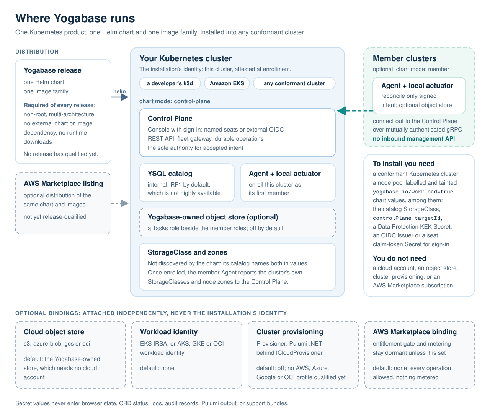

# Yogabase SDKs

English | [한국어](README.ko.md)

Client SDK previews for applications built on **Yogabase**.

Yogabase is a .NET 10 Control Plane that installs into any conformant Kubernetes cluster and gives an application developer a managed database plus sign-in, Lambdas, storage, realtime, and hosted game servers. This repository is deliberately independent of the private Yogabase product repository, its Helm chart, images, Control Plane, and release graph; what it takes from the product is byte-identical copies of the product's published OpenAPI contracts. It contains application-facing, workload-delivery, runtime-host, and Lambda-context client libraries, a Unity package with an Editor publisher, a diagnostic sample, and their contract fixtures; it is not a Kubernetes operator, a cloud-provisioning tool, or a generic management SDK.

> **Preview status:** the packages in this repository are unpublished previews. A successful local build does not authorize publication to NuGet, npm, PyPI, Maven Central, pub.dev, GitHub Packages, or any other registry.

## What Yogabase does

Yogabase gives a team one authoritative place to create, deploy, observe, and operate its databases and application backends on Kubernetes. Its first scope is **Yogabase Core**: a managed YugabyteDB lifecycle with **YSQL** as the supported database API, a Blazor Console, and a central Control Plane; the application platform around it adds sign-in, Lambdas, storage, realtime, and hosted game servers. Cluster provisioning is an optional binding with AWS, Azure, Google Cloud, and Oracle Cloud profiles, none of which has passed qualification yet.

It is one Kubernetes product — one Helm chart and one coordinated image family — that installs into any conformant Kubernetes cluster, from a local k3d cluster to Amazon EKS. An AWS Marketplace listing is one optional distribution of that product, not its identity. The chart has two installation modes:

| Mode | Role |
|---|---|
| `control-plane` | Runs the authoritative Control Plane, Console, REST API, fleet gateway, billing, the local actuator/agent, and its dedicated YSQL catalog (RF1 by default). The Pulumi provisioning worker renders only when provisioning is enabled, Marketplace entitlement and metering stay dormant unless an AWS Marketplace binding is configured, and the Yogabase-owned object store is optional. |
| `member` | Runs the lightweight services installed in each managed cluster: the outbound fleet agent and the deterministic local actuator, plus the optional Yogabase-owned object store. |

The Control Plane is Yogabase's sole source of accepted management intent. A member never exposes an inbound management API, never decides product policy, and never becomes a peer control plane. Members connect **outbound** to the Control Plane over mutually authenticated gRPC, persist signed target-bound intent, and keep reconciling already accepted local work while the Control Plane is unavailable.

## Where Yogabase runs



One Yogabase release — one Helm chart and one image family — installs into any conformant Kubernetes cluster, from a developer's k3d cluster to Amazon EKS. The installation is identified by the cluster it runs in, attested at enrollment: the Control Plane's own cluster enrolls itself as the first member, and further clusters install the same chart in `member` mode and connect outbound. A cloud object store, workload identity, cluster provisioning, and an AWS Marketplace entitlement are each an optional binding attached independently; none of them is the installation's identity, and installing needs none of them. Installing does need a node pool labelled and tainted `yogabase.io/workload=true` and chart values, among them the catalog's StorageClass, `controlPlane.targetId`, a Secret holding the Data Protection key-encryption key, and console sign-in through either an OIDC issuer or a Secret of seat claim tokens. The chart discovers neither a StorageClass nor node zones, so its catalog names both in values; once a cluster is enrolled, its member Agent reports the cluster's StorageClasses and node zones to the Control Plane. The AWS Marketplace listing is one optional distribution of the same chart and images, whose entitlement gate and metering stay dormant unless that binding is configured; it has not yet passed its release qualification.

## Console experience


_A real capture of the Console's Get started page, taken on 2026-09-22 at 1440 px in the light appearance from the product's own browser-test harness with demo data — a project "Arena", its default environment on an enrolled local cluster, and a database the harness marks healthy — not a customer installation or live status. The product repository reproduces it with an explicit capture test (`ReadmeCaptureBrowserTests`) that never runs in its normal suites; two consecutive runs wrote identical files. A developer lands here after signing in: setup status, the environment's infrastructure design, then Data, Compose, and Deploy. The rail groups the Console into Core, Extended, Enterprise, and Operate; Enterprise and Operate start collapsed._

## How the architecture works


Approval follows the installation's approval policy (approved at submission by default), and the Provisioner is present only when the optional provisioning binding is enabled.

The local actuator is intentionally subordinate. It is the only component that writes Yogabase-owned Kubernetes workloads, but it can translate only Control Plane-signed, allowlisted intent into deterministic resources. It does not read arbitrary Secrets, execute commands in Pods, or originate management policy.

### Cloud and target identity

Installation identity is the Kubernetes cluster Yogabase is installed into, attested at enrollment; it is never a console dropdown or a client API parameter. A cloud object store, workload identity, or cluster provisioning is an optional binding attached independently, and a cloud provider names the vendor of such a binding, not the installation. Each member's cluster identity is attested during enrollment. Provisioning, when used, stays behind a .NET `ICloudProvisioner` boundary with Pulumi .NET programs; installing or operating Yogabase never requires it, and the product keeps one provider-neutral Control Plane and one Helm chart.

Console sign-in is the installation's choice of named seats or an external OIDC provider, with an optional AWS IAM Identity Center preset. A console identity never authenticates application or SDK calls.

### Database operations

Core manages logical YugabyteDB database services on selected Kubernetes clusters. It supports YSQL-first database lifecycle, health/topology visibility, explicit RF1/RF3/RF5 topology selection, guarded scale-out, compute resize, storage expansion, allowlisted patch upgrades, safe deletion, retained PVCs, diagnostics, and redacted support bundles. The Console also offers logical encrypted backup, and restore into a new or empty target, as durable operations on each database; neither has passed live qualification yet.

Every change is designed as a durable operation:

1. Yogabase produces a preview of the exact requested change.
2. The request is checked against the current resource revision and an idempotency key.
3. The installation's approval policy decides whether the change waits: the shipped default approves it at submission by installation policy, and independent (four-eyes) approval is an Enterprise-tier opt-in.
4. Accepted work is auditable, recoverable, and reports bounded observed facts rather than fabricated status.

No client SDK contract carries SQL. The Console runs developer DDL and DML only from its Table Editor, SQL Editor, and Migrations page, through the `schema-runner` role as the environment's schema identity, with every write recorded as a digest-bound migration; a Lambda's own code reaches its project database server-side. Yogabase does not expose engine-internal topology as a client contract, remote shell access, `pods/exec` workflows, peer gossip, or an alternate control plane. YCQL, automatic scale-in, PITR, downgrade, and cross-cluster database deployments are outside the current Core scope.

### What happens during an operation


### Security boundaries

YSQL traffic is certificate-based and fail-closed: node-to-node and client-to-server TLS are required, and client certificate identities are explicitly allowlisted. Secret values do not belong in browser state, resource status, logs, audit records, Pulumi output, or support bundles.

The product keeps the public Kubernetes API intentionally small: `YogaDatabase`, `YogaDatabaseOperation`, `YogaApplicationRuntime`, `YogaValkey`, and `YogaRobustMQCluster`. These resources are not a substitute for the Control Plane; they are signed desired-state inputs and bounded local observations.

### Direct and GitOps use

Direct operation through Yogabase is authoritative. GitOps support exports deterministic YAML and diffs for the customer's own local Git workflow; Yogabase does not push branches, create pull requests, or write to customer repositories.

## Custom build delivery and Kubernetes


A custom build reaches Kubernetes through the authoritative Control Plane, never by receiving
Kubernetes or cloud credentials. A developer uploads one archive — from the Console's upload page, or
with a project-scoped `ybt_` developer token through `yogabase build upload`, the .NET
`YogabaseBuildsClient`, or the Unity Editor's Publish Server window — without preparing a manifest,
SBOM, or scan by hand. The Control Plane's Builds ingest stages the archive and derives the service
layout and a detached manifest from the archive and any declared name, version, and ports. The
member's isolated `artifact-admission` Job derives the CycloneDX inventory, scans it with a C# port
of OSV-Scanner's matcher against a digest-pinned OSV snapshot, and signs manifest, inventory, and
scan with the installation's admission key; a refused build names the failing field, or the CVE,
package, version, and fixed-in version. An admitted build is released as a runtime command under the
installation's approval policy, and signed intent travels over the outbound mutually authenticated
fleet channel to the member's subordinate local actuator, which alone reconciles the Kubernetes
workload.

The separately configured Delivery client is the CI path. It uses a short-lived workload OIDC token
to call the TLS-only `/api/v1/delivery` host, which the chart leaves off by default
(`controlPlane.delivery.enabled: false`). It can discover approved templates, preview and submit environments and
immutable artifact admissions, create releases, promote or roll back them, decommission an
environment, abandon a stuck operation, and follow the resulting durable operation through bounded
polling or server-sent events. Its artifact submission carries a credential-free provider-native
locator and exact bundle, manifest, SBOM, and scan-evidence digests.

The server now exposes a versioned runtime-host contract that lets a running build report health
and readiness, be reserved or allocated, and drain on shutdown
(`contracts/yogabase-runtime-host-v1.openapi.json`). `Yogabase.Yogabase.RuntimeHost` implements the
workload side of it as a faithful, modified C# derivative of Agones' client loop shape under
Apache-2.0; see [`docs/REFERENCE_REVIEW.md`](docs/REFERENCE_REVIEW.md) and
[`docs/UNITY_DEDICATED_SERVER.md`](docs/UNITY_DEDICATED_SERVER.md). PlayFlow, Firebase, Supabase,
and the Nakama .NET/Unity client remain reference-only, informing client lifecycle, session,
cancellation, polling, event-stream, and platform ergonomics. `Yogabase.Lambda` adopts the shape of
the Nakama Plus runtime-module API in C# under Apache-2.0, with its licence packed; see
[`docs/REFERENCE_REVIEW.md`](docs/REFERENCE_REVIEW.md).

## Application runtime and SDK boundary

Yogabase can expose a cluster-local application gateway for approved application operations. That is the boundary these SDKs implement:

- Bootstrap returns non-secret, project-bound REST, identity, and separately deployed realtime endpoint configuration.
- Authentication covers signup, login/logout, email confirmation, password reset, MFA and recovery codes, external-identity callbacks, plus authorization code with PKCE and rotating refresh tokens. SDKs never contain confidential client credentials.
- **The mirrored client contract now declares the Data API, and only the generated clients carry it.**
  The Data API module was withdrawn on 2026-09-08 and restored in a new shape by the owner decision of
  2026-09-17: a client selects, inserts, upserts, updates and deletes rows of a project table through
  `POST /v1/data/{table}/select|insert|upsert|update|delete`, under row-level security as the
  signed-in user, and only where the bootstrap's requested-only `data-rest` row says it is served.
  The product implemented it at the gateway on 2026-09-23 and the mirrored contract declares it
  (`x-yogabase-data-api` states its limits and refusal codes, among them the named `413 data_request_too_large`), so the TypeScript, Python, Java and
  Dart clients, which are generated from that contract, carry it. The authored .NET client has no
  Data client yet and does not request the `data-rest` row, and `Yogabase.Lambda` has no typed data
  API or Entity Framework Core support yet (decided 2026-09-17; both stay server-side, and no client
  SDK carries EF code or a model). No package here has called the Data API against a live
  installation.
- Storage is mediated, digest- and idempotency-bound, and never returns provider credentials or signed URLs.
- Stateless Functions invoke an exact registered version through the bounded public contract. A payload is at most 1 MiB before base64, sent inline or as the object an object reference names, and exactly that is accepted; a request over the limit is refused with `413 payload_too_large`, whose problem names `limitBytes` and `maxBodyBytes`, and the .NET client carries both on `YogabaseApiException`. The actor invoke, workflow start and workflow cancel routes refuse over their own limit of 480 KiB with the same problem, and the Data API over its limit with `413 data_request_too_large`; the generated TypeScript, Python and Java clients decode the problem's `code`, `limitBytes` and `maxBodyBytes` for each, and each of those suites has a test that does.
- **Durable Jobs** (owner decision, 2026-10-03): a signed-in user submits a run of a deployed stateless function, reads it, cancels it and fetches its result through `/v1/projects/{projectId}/jobs`, behind the project token's `lambda.invoke` scope. A job type is the id of a deployed function and a job belongs to the user who submitted it. A submit is idempotent per user and key (the key is a member of the request body, not a header; the same request again answers the job it already made, a different one under that key is `409 job_idempotency_conflict`), and a result carries `X-Yogabase-Content-Sha256`. The product's client OpenAPI document describes these routes (`x-yogabase-jobs`, added to it in product commit `1b925cc0` and checked at product `main` `92ac1ced`), so Kiota generates their request builders for TypeScript, Python, Java and Dart, and each language's Jobs client stays authored on top because it carries what a generated builder cannot: the strict response checks, the result route's digest header and the bounds checked before anything is sent. The Java and Dart clients build every request from the generated builders and send it through the Kiota request adapter; the TypeScript and Python clients stay standalone and are held to the generated builders by tests that build each request both ways and compare verb, URL, headers and body; the .NET client has no generated code, so `ContractOperationParityTests` sends its operations and compares the first request with the contract's verb and path. `ContractLimitsAndCodesTests` compares the contract's limits, statuses and refusal codes with every client's constants. On 2026-10-03 the .NET, TypeScript, Python and Java Jobs clients were each also run against the product's real Jobs route code (`MapYogabaseJobs` with its authorization policy, gateway request body policy and result streaming, built from product `main` `92ac1ced` and hosted in-process on loopback over the product's in-memory ledger test double and a stub result reader, so not its object store, its engine SQL or an installation): 25, 26, 24 and 24 end-to-end checks passed, among them the replay and the 409, 422, 404, 403 and 502 refusals, a payload of exactly 1 MiB, a 300 KB result with its digest and the real 413 problems of the Jobs and invoke routes. The harness references the product repository and stays outside this one. They are the .NET `yogabase.Jobs`, the TypeScript `YogabaseJobsClient`, the Python `AsyncJobsClient`, the Java `YogabaseJobsClient` (also `YogabaseApplicationClient.jobs`) and the Dart `YogabaseJobsClient`, which has not been analyzed or run and cannot check the result digest. The Unity build of the .NET client carries the .NET one.
- **Schedules** (product `main` `f9d57e29`; the routes were served and acceptance-tested before the document described them, in `552fdb4f`, and three later commits of 2026-10-03 tightened the document): a signed-in user creates, changes, reads, deletes and runs once a recurring (`cron` in `timeZone`) or one-shot (`oneShotAtUtc`) schedule of a deployed stateless function version through `/v1/projects/{projectId}/schedules/{scheduleId}`, behind the same `lambda.invoke` scope, and a schedule belongs to its creator (another user's is a bare 404, an update of it a 403). A create sends `If-None-Match: *` (201) and an update `If-Match` with the ETag last read (200); a delete (204) and the manual run, `POST …/trigger` with `{idempotencyKey, deadline}` (202; the same key against the same version answers the same invocation), need `If-Match` too. The ETag carries a version the scheduler also advances as it runs, so a client that holds one for long reads the schedule again; a stale precondition is 412 and a missing one 428. A payload is at most 1 MiB (`413 schedule_payload_too_large`); every other refusal is a problem with a fixed title and no code, or no body, and each client names those by status (`precondition_failed`, `precondition_required`, `not_found`, `conflict`, `forbidden`, `unsupported_media_type`, `request_failed`). A write holds the schedule's id to one rule, `^[A-Za-z0-9][A-Za-z0-9._~:-]{0,127}$`, because the id is one segment of the URL path: every client holds a create and an update to it before sending, while a schedule written before the rule under another id is still found by that id (percent-encoded) by a read, a run and a delete, so those three keep the older check and such a schedule can only be deleted and created again. Both policies are required (a request that leaves one out is a 400 naming the member), and `concurrencyPolicy` says what the scheduler does when an occurrence is due while an earlier one has not finished: `Forbid` skips it, `Replace` ends an earlier occurrence that is still queued and skips the new one while one is running (a Lambda that is executing cannot be stopped), a skipped occurrence is consumed, not deferred, and a manual run is not an occurrence, so the policy does not touch it. A manual run of a schedule whose function version is no longer admitted is a 409, as a write of it is. A build of the product from before these changes starts every occurrence whichever policy is chosen, answers that manual run 503 and refuses only an id with a `/` (400). The clients are the .NET `yogabase.Schedules`, the TypeScript `YogabaseSchedulesClient`, the Python `AsyncSchedulesClient`, the Java `YogabaseSchedulesClient` (also `YogabaseApplicationClient.schedules`) and the Dart `YogabaseSchedulesClient`, related to the generated builders as the Jobs clients are. On 2026-10-03 the first four were run against the product's real schedule route code (`MapYogabaseSchedules`, built from product `main` `92ac1ced` over the product's in-memory schedule store test double, so not its store or an installation): 36, 41, 36 and 36 end-to-end checks passed, among them the create, update, delete and run preconditions, the 404 and 403 of another user's schedule, every refusal status, a payload of exactly 1 MiB, the real 413 problem, a run key the queue already holds and a function version that is no longer admitted. That run predates the id rule, the concurrency enforcement and the 409 of a manual run, and was not repeated against product `main` `f9d57e29`. The Dart client has not been analyzed or run, and derives the ETag from the response body because its typed send cannot read headers.
- Actor Lambdas address one versioned, project-local instance; Workflow Lambdas start one immutable definition version and expose only the v1 cancel operation.
- Realtime uses the separately returned SignalR origin for topic subscribe/unsubscribe, signed Lambda-binding invocation, events a Lambda publishes to a topic or addresses to one signed-in user, and at-least-once completion events deduplicated by `eventId` in the authored .NET client. JSON remains the default Hub protocol. The authored .NET client also exposes each event's payload as raw JSON text (`PayloadJson`) beside the typed `JsonElement`, and presence where the bootstrap's requested-only `realtime-presence` row is available: track and untrack the signed-in subject on a topic, read the topic's present subjects, and receive join and leave events.
- Game servers: through `/v1/servers/*` a signed-in player allocates a Ready instance of a hosted service, lists and reads its environment's instances, and releases its own allocation (`stop` never deletes an instance); an allocation returns the address the installation advertises for the instance's node and the ports the member observed. The .NET client also accepts the Agones-shaped typed `address` and `addresses` the product will add once it is the minimum.

Clients are provider-neutral and shard-oblivious. They never receive a cloud selector, cloud credential, Kubernetes identity, TServer address, tablet/shard identifier, shard key, physical placement map, or topology generation. YugabyteDB owns its internal routing and placement; Yogabase observes bounded health and capacity facts without introducing another data-path router.

The SDKs deliberately exclude generic human Control Plane management APIs, infrastructure provisioning, fleet commands, Kubernetes CRDs, approval mutation, remote shell, `pods/exec`, general notifications, analytics, GameSessions, and provider credentials. The only Control Plane surfaces are the workload-authenticated Delivery v1 contract described above, the Builds v1 build-ingest contract that a developer tool (the .NET `YogabaseBuildsClient` or the Unity Editor publisher) calls with a project-scoped `ybt_` developer token, and the self-scoped Runtime Host v1 contract that a hosted workload reaches over loopback through its Pod-local relay, which accepts no application or Delivery credential and exposes no allocation call to the workload.

Owner decisions recorded on 2026-09-17 changed these surfaces. The product implements each of the following, and where it belongs to a mirrored contract that contract now carries it; each item says what these packages do with it:

- A Lambda uploaded through Builds must declare its execution kind (`Stateless` or `Stateful`) and its realtime ingress and egress binding ids; an upload without them is refused at ingest with `400 BUILD_LAMBDA_DECLARATION_REQUIRED` (builds contract). `YogabaseBuildsClient` sends it when a request sets `Lambda`, and the Unity publisher when its settings publish a Lambda archive; a server upload sends none of it. A bundle whose entry is `RegisterLambdas` also states the Lambda ids it registers in `registeredLambdaIds` (refused when missing with `BUILD_LAMBDA_REGISTRATION_REQUIRED`, and refused beside a single-function bundle); both tools send it only for a registering bundle.
- A Lambda's realtime publish to a topic its function version did not declare is refused with `403 realtime_binding_not_declared` (the Lambda runtime API, which no mirrored contract describes); `Yogabase.Lambda` surfaces it as a `LambdaApiException` with status 403 and that code.
- The runtime-host assignments page carries an additive `headState` and `headSequence` (runtime-host contract); the runtime-host client here does not read them yet.
- The client bootstrap adds a requested-only `realtime-presence` row for a client that names it in `X-Yogabase-Accept-Capabilities`, and the realtime Hub gains `TrackPresence`, `UntrackPresence` and `GetPresence` (application contract). The .NET client requests the row and implements all three calls and the `presence` event; the other languages have no realtime client.
- A game-server allocation's `host` is the address the installation advertises for the instance's node, picked the way Agones picks one, rather than a node-internal address. Typed `address` and `addresses` fields are decided, and the product emits them only once an SDK that accepts them is the minimum; the .NET client reads them when present (`Address`, `Addresses` on the instance and on each port) and the other languages' generated clients keep unknown fields as additional data.

## Capability truth

Yogabase reports module and protocol availability from signed observations and release-locked evidence. Configuration alone is never treated as a successful deployment. A capability gate opens on passing local conformance evidence (k3d runs and in-process rehearsals); real-cloud runs are follow-up validation, not prerequisites.

| Area | Current boundary |
|---|---|
| Core | The primary product scope: managed YugabyteDB/YSQL operations as durable operations under the installation's approval policy (approved at submission by default; four-eyes approval is an Enterprise opt-in). |
| Application modules | Authentication, Storage, Realtime (SignalR), and Remote Config ship enabled in the chart. Realtime requires Authentication, and Storage reports that it is waiting for an object store until one is bound. |
| YB Lambda (formerly Extended) | Stateless Functions, Actor Lambdas, Workflow Lambdas, Dynamic Code, the sandbox, Scheduler/Jobs and consumer triggers, plus hosted self-contained services, with optional Orleans, SignalR, Redis (Valkey), Kafka and RabbitMQ/AMQP (RobustMQ) APIs. These ship enabled in the chart, and the capabilities behind compiled evidence gates (hosted services, the runtime host, consumers and consumer triggers, and the Lambda Valkey and RobustMQ APIs) are qualified on local evidence (in-process rehearsals and k3d conformance runs). A function written in the Console is compiled, scanned, and signed by the installation's own builder and then released; the separate dynamic Stateless and Actor Lambda modules, which execute customer-submitted C# on demand, stay off, and Lambdas triggered from a RobustMQ AMQP queue are out of the current scope. A Lambda-side typed data API and Entity Framework Core (decided 2026-09-17) were implemented in the product on 2026-09-23; the `Yogabase.Lambda` wrapper in this repository does not wrap them. The Console groups YB Lambda with Authentication, Storage, Realtime, Remote Config, Valkey and RobustMQ under its Extended tier. |
| Valkey | Uses a Yogabase-owned C# reconciler. Lifecycle, Job-actuated promotion, and Redis protocol semantics are qualified on local conformance evidence, as is direct Lambda access over TLS under a per-project ACL identity; real-cloud runs remain follow-up validation. |
| RobustMQ | Uses a bounded Yogabase-owned C# lifecycle port. Lifecycle and authenticated MQTT are qualified on local evidence, as are gateway-mediated Lambda publication over MQTT, Kafka and AMQP and Kafka consumer triggers. Native Kafka and AMQP client TLS, and arbitrary external Kafka or AMQP clients of the broker, remain unqualified. |
| Enterprise | Independent (four-eyes) approval is the Enterprise-tier policy an installation opts into. The Console's Enterprise group lists Audit, Approvals, Authorizations, database SWE assurance tiers, Migrations, and Backup and locks every row on a pre-Enterprise installation, although audit records, schema migrations, and database backup operations exist on every tier; database assurance tiers are not implemented on any tier. |

This README describes product architecture and boundaries, not a promise that a disabled or evidence-gated capability is currently enabled.

## Packages

The non-.NET package identifiers retain their existing preview names for continuity. They do not imply registry publication or a support commitment. Version `0.3` added the workload-authenticated Control Plane Delivery v1 surface and cross-platform lifecycle improvements. The application contract has changed since without a version change: the client-facing Data API was removed (2026-09-08) and restored in the contract (2026-09-23, so only the generated clients carry it), the `/v1/servers/*` game-server surface was added, the function invoke route gained its named `413 payload_too_large` refusal (and the actor, workflow, Jobs, schedule and Data routes their own), the durable Jobs routes and the schedule routes were described in it on 2026-10-03, and the .NET package gained its Servers, Builds, durable Jobs and Schedules clients, all still versioned `0.3.0-preview.1`.

| Platform | Location | Current package identity | Qualification |
|---|---|---|---|
| .NET | `src/dotnet/Yogabase.Yogabase.Client` | `Yogabase.Yogabase.Client` `0.3.0-preview.1` | Authored application, PKCE, SignalR, Delivery, game-server, durable Jobs, Schedules, and build clients; `netstandard2.1` and `net10.0`; fake-transport tests (on 2026-10-03 the client suite's 448 cases, 737 across the solution, passed) and the in-process runs against the product's route code described above, no live installation evidence |
| TypeScript | `languages/typescript` | `@stackyoga/yogabase-client-preview` `0.3.0-preview.1` | Generated application client (including the Jobs and schedule request builders) plus an authored headless password sign-in (`YogabaseSession`, Node only) and Delivery, Jobs, Schedules and storage-key facades; on 2026-10-07 its 98 tests ran on Node 25.9.0, 97 passed and the live smoke test was skipped |
| Python | `languages/python` | `stackyoga-yogabase-client-preview` `0.3.0.dev1` | Generated application client (including the Jobs and schedule request builders) plus a headless password sign-in and authored async Delivery, Jobs, Schedules and storage-key facades; hash-locked dependencies (`requirements.lock`, `build-requirements.lock`) and an exactly pinned `setuptools==84.0.0` backend; its own HTTP clients trust the platform certificate store, although `certifi` stays installed because httpx and httpcore require it; on 2026-09-22 its 23 tests passed from source on CPython 3.13.12 and 3.12.13, a wheel and sdist built from the locks, and the same 23 tests passed against the installed wheel in a clean virtual environment; on 2026-10-03 its 101 tests (the 23 and the Jobs, Schedules, Data, 413 and schedule id cases added since) passed from source on both interpreters under `-X dev` with `ResourceWarning` as an error, and on 2026-10-07 its 111 (110 passed, the live smoke test skipped) did the same after a headless password sign-in was added; the wheel was not rebuilt, and only Python 3.12 and 3.13 are claimed |
| Java/JVM | `languages/java` | `io.stackyoga:yogabase-client-preview` `0.3.0-preview.1` | Generated application/Delivery clients plus authored JVM facades, including the Jobs and Schedules clients (both built over the generated request builders); Kotlin/JVM interop path; on 2026-10-03 its main-class checks (Delivery, storage key, Jobs 336, Schedules 1988, generated surface 26) passed compiled with `javac --release 17` against Kiota 1.9.3 |
| Dart | `languages/dart` | `stackyoga_yogabase_client_preview` `0.3.0-dev.1` | Experimental generated application/Delivery source plus authored facades; on 2026-09-17, with the checksum-verified Dart 3.13.2 SDK, `dart pub get --enforce-lockfile` succeeded, `dart analyze` reported no issues, and the standalone source checks passed (there is no `package:test` suite); the source regenerated on 2026-10-03 (twice), the Jobs client rebuilt over the generated builders and the Schedules client written then, which that day was also changed to hold a write's id to the contract's pattern (with their standalone checks), have not been analyzed or run, because no Dart SDK is installed on that machine |
| .NET Lambda context | `src/dotnet/Yogabase.Lambda` | `Yogabase.Lambda` `0.1.0-preview.1` | Authored runtime-context wrapper for a Lambda bundle: project database, Storage, Users, Realtime (including publishing to one user), the caller, Actor, Workflow, and reminder calls, direct Valkey access and the runtime `IDistributedCache`, gateway-mediated MQTT, Kafka, and AMQP publication, stream reads and partition declarations, durable-queue receive with acknowledgement, and a typed `yogabase.cdc.v1` change-event and record-key parser; `netstandard2.1` and `net10.0` (the database handle only on `net10.0`); no typed data API or Entity Framework support yet (decided 2026-09-17); fake-provider tests only, no live installation evidence |
| .NET runtime host | `src/dotnet/Yogabase.Yogabase.RuntimeHost` | `Yogabase.Yogabase.RuntimeHost` `0.1.0-preview.1` | Authored self-scoped runtime-host client; `netstandard2.1` and `net10.0`; waits out `503 RUNTIME_HOST_INSTANCE_PENDING` on a heartbeat or Ready call for up to `StartupPendingBudget` per call (default 60 seconds) using the refusal's `RetryAfterSeconds`, and reports background heartbeat failures through `Connect(onHeartbeatFailure)` (added without a version change); fake-transport tests only in this repository — an earlier copy ran live only as the Unity package's 0.1.0 runtime module |
| Unity builds (8.0 line) | `src/unity/Yogabase.Yogabase.Client.Unity`, `src/unity/Yogabase.Yogabase.RuntimeHost.Unity` | not packaged; assemblies `Yogabase.Yogabase.Client` `0.3.0-preview.1` and `Yogabase.Yogabase.RuntimeHost` `0.2.3-preview.1` | The same sources as the two .NET packages, compiled for `netstandard2.1` only against SignalR 8.0.15 and System.Text.Json 8.0.5 (`src/unity/Directory.Packages.props`), because Unity 6000.5 binds its own 8.0 BCL extensions and a plugin built against 10.x is CS1705 there (owner decision, 2026-09-17). `UnityBuildTests` pins that neither build references or locks anything at 9.x or above; both builds are deterministic. A Unity project takes these as digest-locked assemblies |
| Unity | `languages/unity/com.stackyoga.yogabase-runtime-host` | `com.stackyoga.yogabase-runtime-host` `0.2.3-preview.1` | UPM package carrying the runtime-host module (with the startup wait-out above and the one-read page head), its `link.xml`, and the Editor publish flow (`Yogabase ▸ Publish Server`), which also publishes a prebuilt Lambda archive with its execution declaration and, for a `RegisterLambdas` bundle, its `registeredLambdaIds`; its Runtime folder and Editor scripts compile at C# 9 against Unity 6000.5.7f1 reference sets, but no Unity Editor import of this version is recorded, no IL2CPP build carries it, no live relay session has run it, and no Editor has run the publish window. The 0.1.0 runtime module did run live in an IL2CPP dedicated server (see Platform qualification) |
| .NET sample | `samples/dotnet/Yogabase.ServerPathProbe` | not a package | Editor-free diagnostic walk of the server-side game path (server start, one UDP datagram, a Lambda invoke, an optional realtime subscription) with a player access token read only from environment variables; argument, sign-in-context, and preview tests only, never run against a live installation |

The immutable application snapshot is `contracts/yogabase-client-v1.openapi.json` (SHA-256 `e2de1433c884098e33e867eef06e300e6dacb11aca462477557cdd97bb5787ed`); it carries the player-facing `/v1/servers/*` game-server surface, the restored `/v1/data/{table}/*` Data API, the `413` refusals of the function, actor, workflow, Jobs, schedule and Data routes, the durable Jobs routes (`/v1/projects/{projectId}/jobs`) and the schedule routes (`/v1/projects/{projectId}/schedules/{scheduleId}` and its `/trigger`), which are therefore generated for TypeScript, Python, Java and Dart (33 paths, 36 operations and 47 schemas). The build-ingest snapshot is `contracts/yogabase-builds-v1.openapi.json` (SHA-256 `368a15e2baa2567983894752444cf7efe5687da2e40b461cef7523d124923750`); it is a developer-tool surface reached with a project-scoped `ybt_` developer token, implemented by the .NET `YogabaseBuildsClient` and the Unity Editor package and deliberately not generated for the other languages. The workload snapshot is `contracts/yogabase-delivery-v1.openapi.json` (SHA-256 `d44f95c0364d49071aa29e0d555687c942d91acbc9215cb71bd1eefb294d9c39`). The runtime-host snapshot is `contracts/yogabase-runtime-host-v1.openapi.json` (SHA-256 `c09a0842c3e295685a4112638ea74a6ab23e3b390fe2f6ab0e1a635f1e6797e2`); it is checked in as the server-side reference for the lifecycle states and error codes and is deliberately never code-generated, because a workload calls the self-scoped relay routes rather than the instance-addressed paths that document declares. Their adjacent checksums, Kiota locks, and `MANIFEST.json` bind this repository to the exact contracts and generator.

Every document under `contracts/` is a byte-identical copy of the product repository's `docs/api/` file of the same name as of its last mirror (the product's `main` at `f9d57e29` on 2026-10-03; the client document last changed in `a95d2347` and the delivery document in `ec3c58b5`, the builds and runtime-host documents being unchanged since `1f7ad8a3` and `87469584`). `ContractDigestTests` pins each file to its `.sha256` sidecar and to the digests published in `MANIFEST.json` and both READMEs; it cannot see the product repository, so it does not itself prove byte identity. `MANIFEST.json` also pairs each generated contract's digest with the description hash Kiota wrote into the generated trees' locks, and `ContractOperationParityTests` fails when the mirrored application contract holds an operation that a shipped language has no surface for. The former `contracts/planned/` documents were written here while the product implemented the build and game-server surfaces; the product has published both, so they were deleted rather than reconciled.

## Local verification

```text
dotnet restore Yogabase.SDKs.slnx --locked-mode
dotnet build Yogabase.SDKs.slnx -c Release --no-restore
dotnet test Yogabase.SDKs.slnx -c Release --no-restore --no-build
dotnet pack src/dotnet/Yogabase.Yogabase.Client/Yogabase.Yogabase.Client.csproj -c Release --no-restore
dotnet pack src/dotnet/Yogabase.Yogabase.RuntimeHost/Yogabase.Yogabase.RuntimeHost.csproj -c Release --no-restore
dotnet pack src/dotnet/Yogabase.Lambda/Yogabase.Lambda.csproj -c Release --no-restore

cd languages/typescript && npm ci && npm test
cd languages/python && python3 -m venv .venv && .venv/bin/python -m pip install --require-hashes -r requirements.lock -r build-requirements.lock
cd languages/python && PYTHONPATH=src .venv/bin/python -m unittest discover -s tests && .venv/bin/python -m build --no-isolation
cd languages/java && javac --release 17 -cp '<kiota 1.9.3 and jakarta.annotation-api 2.1.1 jars>' -d out $(find src -name '*.java') && java -cp 'out:<same jars>' io.stackyoga.yogabase.YogabaseDeliveryClientTest && java -cp 'out:<same jars>' io.stackyoga.yogabase.YogabaseJobsClientTest && java -cp 'out:<same jars>' io.stackyoga.yogabase.YogabaseSchedulesClientTest && java -cp 'out:<same jars>' io.stackyoga.yogabase.YogabaseGeneratedSurfaceTest && java -cp 'out:<same jars>' io.stackyoga.yogabase.YogabaseStorageLogicalKeyTest   # the checks are main-method programs; mvn test would run none of them; the classpath also needs OkHttp 4.12.0, Okio 3.6.0, Gson 2.14.0 and the Kiota runtime's other jars
cd languages/dart && dart pub get --enforce-lockfile && dart analyze && dart run test/yogabase_delivery_source_test.dart && dart run test/yogabase_jobs_source_test.dart && dart run test/yogabase_schedules_source_test.dart

scripts/compile-unity-editor.sh
```

`scripts/compile-unity-editor.sh` compile-checks the Unity package's Editor scripts (not its Runtime
folder) in a real Unity Editor compile environment: it reuses a response file Unity's own Bee build
already wrote for an Editor assembly, keeps its Editor-installation references, defines and language
version, and swaps in this package's sources. Set `UNITY_RSP` to point at one; without it the script
looks in one default local Unity projects folder. If it finds no response file, or no Roslyn
compiler under the .NET SDK, it exits 2 and says the scripts were not checked, rather than reporting
a pass it did not perform.

Run `scripts/regenerate-clients.sh` to verify all four contracts, restore pinned Kiota 1.34.1, regenerate all four application clients, and regenerate the Java and Dart delivery protocol clients. The runtime-host and builds contracts are checksum-verified but never generated, and the authored runtime-host, builds, and Lambda modules are not regenerated source. Authored delivery facades are preserved. Each generated-language folder retains its own package manifest, dependency lock where available, Kiota lock, source, documentation, and conformance helper. Downloaded tools, caches, dependency trees, and build intermediates are excluded. Historical imported artifacts remain unchanged under `artifacts/imported`; current sibling-repository builds belong under `artifacts/local`.

### Connecting a client to a self-hosted installation

The .NET client's public entry point is `Yogabase.Yogabase.YogabaseClient`. It has no public constructor; a consumer creates it through the static `YogabaseClient.CreateAsync(Uri gatewayEndpoint, string publishableKey, YogabaseClientOptions? options = null, CancellationToken cancellationToken = default)` factory. `gatewayEndpoint` is the installation's application-gateway origin — exactly the origin the installation's client configuration names, because `CreateAsync` refuses any other origin with `client_config_origin_mismatch` — and `publishableKey` is the project's publishable key. Plain `http://` is accepted only for a loopback origin with `AllowInsecureLoopback`.

```csharp
using Yogabase.Yogabase;

await using var yogabase = await YogabaseClient.CreateAsync(
    new Uri("https://<installation-host>"),
    "<publishable-key>");

await yogabase.Auth.SignInWithPasswordAsync("<user-email>", "<user-password>");
```

`<installation-host>` and `<publishable-key>` are placeholders; this repository does not choose either. The hostname of a self-hosted installation and the publishable key for a given project are both supplied by that installation's owner. A real publishable key begins with `sy_pub_`, and `CreateAsync` rejects one that does not.

`SignInWithPasswordAsync` signs the user in with no browser and keeps the tokens every other call uses. The user must already exist: a user signs up with an e-mail address and a password (a project's gateway runs with open sign-up) and, unless a self-hosted installation turned confirmation off, must confirm the address before signing in; with no e-mail transport a sign-up then answers `503 authentication_email_unavailable`. The [client's README](src/dotnet/Yogabase.Yogabase.Client/README.md#getting-started) lists the refusals. Nothing is published, so reference the client's project from a checkout of this repository. The TypeScript client signs in the same way, for Node only, with `YogabaseSession.signInWithPassword`; see its [README](languages/typescript/README.md#getting-started).

The Python client signs in the same way: `session = await sign_in_with_password("https://<installation-host>", "<publishable-key>", "<user-email>", "<user-password>")` returns a session that is the Kiota authentication provider and the token source of the Jobs and schedules clients, with the same refusals as a `YogabaseAuthError`; see its [Getting started](languages/python/README.md#getting-started). It is unpublished and supports Python 3.12 and 3.13, the two versions it has run on.

A publishable key is not a secret. It identifies the project to the gateway and is safe to ship in client code, and it authenticates nothing: the bootstrap document it fetches carries endpoints, identifiers, and capability facts only. Yogabase issues no privileged counterpart key that a client could hold instead. Every authenticated call carries a per-user access token obtained from the project's OIDC authority, so a client never ships a credential that speaks for the project as a whole.

On an installation that uses named console seats, a seat is claimed on the installation's Console at `https://<console-host>/console-seat/claim`. The Console host is supplied by the installation's owner and is generally not the application-gateway host above, and a console seat never authenticates SDK calls.

## Platform qualification

Generated REST source is not the same as a production-qualified platform integration. `netstandard2.1` compatibility alone does not qualify Unity or AOT. The Python package passed its tests from source and from its built wheel on 2026-09-22, and the Dart package passed analysis and its standalone source checks on 2026-09-17 (local macOS arm64 toolchains only). Android, Flutter, Kotlin/JVM runtime integration, Unity IL2CPP of the application client, native secure storage, interactive-cookie handling, non-.NET SignalR integration, and live-gateway conformance each still need explicit platform evidence before they can be claimed as supported.

The runtime-host module and its Unity package are authored against the checked-in contract and covered in this repository by fake-transport unit tests. The Unity package's 0.1.0 runtime module has run live: compiled by Unity 6000.5.7f1 into an IL2CPP Linux arm64 dedicated server and hosted on a self-hosted Yogabase installation, its heartbeat and Ready calls were accepted through the Pod-local relay, first on 2026-09-07, when the instance reached Ready, and again on 2026-09-16 and 2026-09-17. That run also showed that assignment polls carrying the query-string `resumeToken` never advanced past the first page, because the product's relay dropped the query string; the product fix made on 2026-09-17 has not yet been observed live, and no allocation has yet been delivered to a build through the relay. The current versions — the .NET package and Unity package 0.2.3, including the startup wait-out and the page head — have not run in an IL2CPP build or against a live relay, and the per-family runtime-host conformance battery (restart, replay, duplicate, stale-epoch, double-allocation, reservation-expiry, disconnect, Pod-replacement, drain/shutdown-race, credential-confusion, and secret-negative cases) has not been run. Treat both as unqualified previews.
