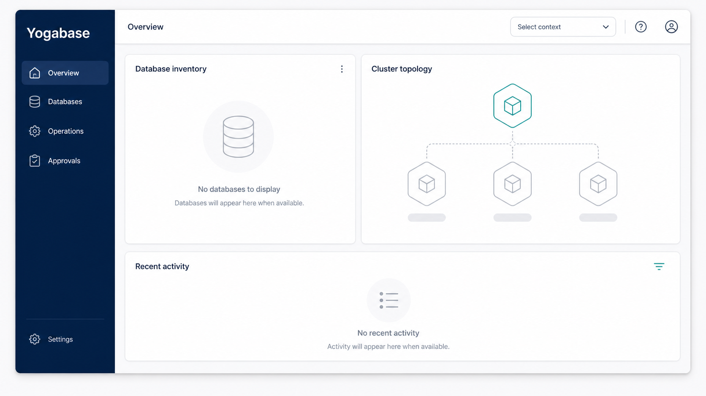

# Yogabase SDKs

Client SDK previews for applications built on **Yogabase**.

Yogabase is a .NET 10 control plane for operating data services across Kubernetes. This repository is deliberately independent of the private Yogabase product repository, its Helm chart, images, Control Plane, and Marketplace delivery graph. It contains application-facing client libraries and their contract fixtures only; it is not a Kubernetes operator, a cloud-provisioning tool, or a management SDK.

> **Preview status:** the packages in this repository are unpublished previews. A successful local build does not authorize publication to NuGet, npm, PyPI, Maven Central, pub.dev, GitHub Packages, or any other registry.

## What Yogabase does

Yogabase gives a team one authoritative place to plan, approve, deploy, observe, and operate its data services on Kubernetes. The first product scope is **Yogabase Core**: a managed YugabyteDB lifecycle with **YSQL** as the supported database API, a Blazor Console, a central Control Plane, and portable Kubernetes provisioning for AWS, Azure, Google Cloud, and Oracle Cloud qualification profiles.

It is one Kubernetes Marketplace product delivered through one Helm chart and one coordinated image family. The chart has two installation modes:

| Mode | Role |
|---|---|
| `control-plane` | Runs the authoritative Control Plane, Console, REST API, fleet gateway, provisioning workflow, billing/metering, local actuator/agent, and its dedicated RF1 YSQL catalog. |
| `member` | Runs the lightweight services installed in each managed target: the outbound fleet agent and the deterministic local actuator. |

The Control Plane is Yogabase's sole source of accepted management intent. A member never exposes an inbound management API, never decides product policy, and never becomes a peer control plane. Members connect **outbound** to the Control Plane over mutually authenticated gRPC, persist signed target-bound intent, and keep reconciling already accepted local work while the Control Plane is unavailable.

## Console experience



_Illustrative Console concept, not a live environment or status display. It uses empty states intentionally and does not represent customer data, metrics, or enabled capabilities._

## How the architecture works


The local actuator is intentionally subordinate. It is the only component that writes Yogabase-owned Kubernetes workloads, but it can translate only Control Plane-signed, allowlisted intent into deterministic resources. It does not read arbitrary Secrets, execute commands in Pods, or originate management policy.

### Cloud and target identity

Cloud provider selection is an installation identity, not a console dropdown or client API parameter. The Marketplace release fixes the Control Plane provider; each member's provider and managed-cluster kind are attested during enrollment and become immutable target identity. Provisioning remains behind a .NET `ICloudProvisioner` boundary and uses Pulumi .NET programs, while the product retains one provider-neutral Control Plane and one Helm chart.

### Database operations

Core manages logical YugabyteDB database services on selected Kubernetes targets. It supports YSQL-first database lifecycle, health/topology visibility, explicit RF1/RF3/RF5 topology selection, guarded scale-out, compute resize, storage expansion, optional logical encrypted backup, restore into a new or empty target, allowlisted patch upgrades, safe deletion, retained PVCs, diagnostics, and redacted support bundles.

Every change is designed as a durable operation:

1. Yogabase produces a preview of the exact requested change.
2. The request is checked against the current resource revision and an idempotency key.
3. Risky work requires the appropriate approval.
4. Accepted work is auditable, recoverable, and reports bounded observed facts rather than fabricated status.

Yogabase does not expose arbitrary SQL, engine-internal topology as a client contract, remote shell access, `pods/exec` workflows, peer gossip, or an alternate control plane. YCQL, automatic scale-in, PITR, downgrade, and cross-cluster database deployments are outside the current Core scope.

### What happens during an operation


### Security boundaries

YSQL traffic is certificate-based and fail-closed: node-to-node and client-to-server TLS are required, and client certificate identities are explicitly allowlisted. Secret values do not belong in browser state, resource status, logs, audit records, Pulumi output, or support bundles.

The product keeps the public Kubernetes API intentionally small: `YogaDatabase`, `YogaDatabaseOperation`, `YogaApplicationRuntime`, `YogaValkey`, and `YogaRobustMQCluster`. These resources are not a substitute for the Control Plane; they are signed desired-state inputs and bounded local observations.

### Direct and GitOps use

Direct operation through Yogabase is authoritative. GitOps support exports deterministic YAML and diffs for the customer's own local Git workflow; Yogabase does not push branches, create pull requests, or write to customer repositories.

## Application runtime and SDK boundary

Yogabase can expose a target-local application gateway for approved application operations. That is the boundary these SDKs implement:

- Bootstrap returns non-secret, project-bound logical endpoint configuration.
- Authentication uses authorization code with PKCE and rotating refresh tokens. SDKs never contain confidential client credentials.
- Data exposes only approved typed operations; arbitrary SQL is not part of the client surface.
- Storage is mediated, digest- and idempotency-bound, and never returns provider credentials or signed URLs.
- Functions invoke an exact registered version through the bounded public contract.
- Realtime exposes only the qualified SignalR subscription lifecycle.

Clients are provider-neutral and shard-oblivious. They never receive a cloud selector, cloud credential, Kubernetes identity, TServer address, tablet/shard identifier, shard key, physical placement map, or topology generation. YugabyteDB owns its internal routing and placement; Yogabase observes bounded health and capacity facts without introducing another data-path router.

The SDKs deliberately exclude Control Plane management APIs, infrastructure provisioning, fleet commands, Kubernetes CRDs, approval workflows, remote shell, `pods/exec`, general notifications, analytics, GameSessions, and provider credentials.

## Capability truth

Yogabase reports module and protocol availability from signed observations and release-locked evidence. Configuration alone is never treated as a successful deployment.

| Area | Current boundary |
|---|---|
| Core | The primary product scope: managed YugabyteDB/YSQL operations with durable, approval-aware workflows. |
| Extended | Scoped to Functions, Actor Lambdas, Workflow Lambdas, Dynamic Code, sandboxing, and Scheduler/Jobs. Capabilities remain unavailable until their own runtime evidence qualifies them. |
| Valkey | Uses a Yogabase-owned C# reconciliation path. Promotion and Redis protocol claims remain gated on live qualification evidence. |
| RobustMQ | Uses a bounded Yogabase-owned C# lifecycle port. Lifecycle and Kafka/AMQP/MQTT protocol claims remain unavailable until independently qualified. |

This README describes product architecture and boundaries, not a promise that a disabled or evidence-gated capability is currently enabled.

## Packages

The package identifiers below retain their current preview names. They do not imply a product rename, registry publication, or support commitment.

| Platform | Location | Current package identity | Qualification |
|---|---|---|---|
| .NET | `src/dotnet/StackYoga.YogaBase.Client` | `StackYoga.YogaBase.Client` `0.1.0-preview.1` | Authored; `netstandard2.1` and `net10.0`; local tests and package build |
| TypeScript | `languages/typescript` | `@stackyoga/yogabase-client-preview` `0.1.0-preview.1` | Kiota-generated preview plus storage-key adapter |
| Python | `languages/python` | `stackyoga-yogabase-client-preview` `0.1.0.dev1` | Kiota-generated preview plus storage-key adapter |
| Java/JVM | `languages/java` | `io.stackyoga:yogabase-client-preview` `0.1.0-preview.1` | Kiota-generated preview and current Kotlin/JVM interop path |
| Dart | `languages/dart` | `stackyoga_yogabase_client_preview` `0.1.0-dev.1` | Experimental generated source; local Dart compilation is unqualified |

The immutable API snapshot is `contracts/yogabase-client-v1.openapi.json`. Its adjacent checksum and `MANIFEST.json` bind this repository to the exact contract and imported artifacts.

## Local verification

```text
dotnet restore StackYoga.SDKs.slnx --locked-mode
dotnet build StackYoga.SDKs.slnx -c Release --no-restore
dotnet test --solution StackYoga.SDKs.slnx -c Release --no-restore --no-build
dotnet pack src/dotnet/StackYoga.YogaBase.Client/StackYoga.YogaBase.Client.csproj -c Release --no-restore
```

Each generated-language folder retains its own manifest, dependency lock where available, Kiota lock, source, documentation, and conformance helpers. Downloaded tools, caches, dependency trees, and build intermediates are excluded. Imported source artifacts remain under `artifacts/imported`; sibling-repository builds belong under `artifacts/local`.

## Platform qualification

`netstandard2.1` compatibility alone does not qualify Unity or AOT. Android, Flutter, Dart, Kotlin/JVM, Unity IL2CPP, native secure storage, redirect handling, and live-gateway conformance each need explicit platform evidence before they can be claimed as supported.
