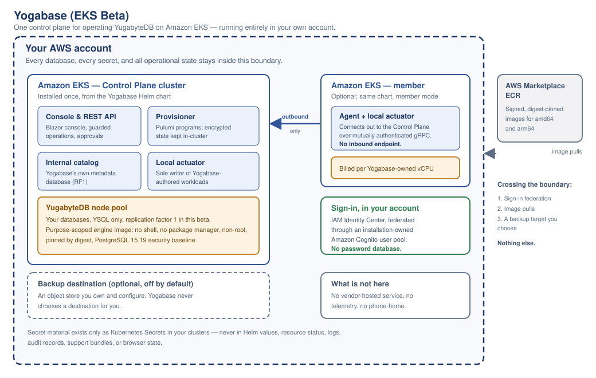

# Yogabase SDKs

English | [한국어](README.ko.md)

Client SDK previews for applications built on **Yogabase**.

Yogabase is a .NET 10 Control Plane that installs into any conformant Kubernetes cluster and gives an application developer a managed database plus sign-in, Lambdas, storage, realtime, and hosted game servers. This repository is deliberately independent of the private Yogabase product repository, its Helm chart, images, Control Plane, and release graph; what it takes from the product is byte-identical copies of the product's published OpenAPI contracts. It contains application-facing, workload-delivery, runtime-host, and Lambda-context client libraries, a Unity package with an Editor publisher, a diagnostic sample, and their contract fixtures; it is not a Kubernetes operator, a cloud-provisioning tool, or a generic management SDK.

> **Preview status:** the packages in this repository are unpublished previews. A successful local build does not authorize publication to NuGet, npm, PyPI, Maven Central, pub.dev, GitHub Packages, or any other registry.

## What Yogabase does

Yogabase gives a team one authoritative place to create, deploy, observe, and operate its databases and application backends on Kubernetes. Its first scope is **Yogabase Core**: a managed YugabyteDB lifecycle with **YSQL** as the supported database API, a Blazor Console, and a central Control Plane; the application platform around it adds sign-in, Lambdas, storage, realtime, and hosted game servers. Cluster provisioning is an optional binding with AWS, Azure, Google Cloud, and Oracle Cloud profiles, none of which has passed qualification yet.

It is one Kubernetes product — one Helm chart and one coordinated image family — that installs into any conformant Kubernetes cluster, from a local k3d cluster to Amazon EKS. An AWS Marketplace listing is one optional distribution of that product, not its identity. The chart has two installation modes:

| Mode | Role |
|---|---|
| `control-plane` | Runs the authoritative Control Plane, Console, REST API, fleet gateway, billing, the local actuator/agent, and its dedicated YSQL catalog (RF1 by default). The Pulumi provisioning worker renders only when provisioning is enabled, Marketplace entitlement and metering stay dormant unless an AWS Marketplace binding is configured, and the Yogabase-owned object store is optional. |
| `member` | Runs the lightweight services installed in each managed cluster: the outbound fleet agent and the deterministic local actuator, plus the optional Yogabase-owned object store. |

The Control Plane is Yogabase's sole source of accepted management intent. A member never exposes an inbound management API, never decides product policy, and never becomes a peer control plane. Members connect **outbound** to the Control Plane over mutually authenticated gRPC, persist signed target-bound intent, and keep reconciling already accepted local work while the Control Plane is unavailable.

## AWS Marketplace distribution (optional)



This diagram shows the optional AWS Marketplace distribution on Amazon EKS as first drawn for its beta; the same chart installs into any conformant Kubernetes cluster. In that distribution, databases, secrets, and operational state stay inside the customer's AWS account, members connect outbound-only to the authoritative Control Plane, and the customer controls the optional backup destination. That distribution has not yet passed its release qualification.

## Console experience


_Early Console concept, not a live environment or status display. It predates the current Console: it shows an AWS Marketplace/EKS installation badge and an operations-first navigation, whereas an installation is now identified by its Kubernetes cluster and a developer lands on Get started. It intentionally uses empty states and does not represent customer data, metrics, or enabled capabilities._

## How the architecture works


Approval follows the installation's approval policy (approved at submission by default), and the Provisioner is present only when the optional provisioning binding is enabled.

The local actuator is intentionally subordinate. It is the only component that writes Yogabase-owned Kubernetes workloads, but it can translate only Control Plane-signed, allowlisted intent into deterministic resources. It does not read arbitrary Secrets, execute commands in Pods, or originate management policy.

### Cloud and target identity

Installation identity is the Kubernetes cluster Yogabase is installed into, attested at enrollment; it is never a console dropdown or a client API parameter. A cloud object store, workload identity, or cluster provisioning is an optional binding attached independently, and a cloud provider names the vendor of such a binding, not the installation. Each member's cluster identity is attested during enrollment. Provisioning, when used, stays behind a .NET `ICloudProvisioner` boundary with Pulumi .NET programs; installing or operating Yogabase never requires it, and the product keeps one provider-neutral Control Plane and one Helm chart.

Console sign-in is the installation's choice of named seats or an external OIDC provider, with an optional AWS IAM Identity Center preset. A console identity never authenticates application or SDK calls.

### Database operations

Core manages logical YugabyteDB database services on selected Kubernetes clusters. It supports YSQL-first database lifecycle, health/topology visibility, explicit RF1/RF3/RF5 topology selection, guarded scale-out, compute resize, storage expansion, allowlisted patch upgrades, safe deletion, retained PVCs, diagnostics, and redacted support bundles. The Console also offers logical encrypted backup, and restore into a new or empty target, as durable operations on each database; neither has passed live qualification yet.

Every change is designed as a durable operation:

1. Yogabase produces a preview of the exact requested change.
2. The request is checked against the current resource revision and an idempotency key.
3. The installation's approval policy decides whether the change waits: the shipped default approves it at submission by installation policy, and independent (four-eyes) approval is an Enterprise-tier opt-in.
4. Accepted work is auditable, recoverable, and reports bounded observed facts rather than fabricated status.

No client SDK contract carries SQL. The Console runs developer DDL and DML only from its Table Editor, SQL Editor, and Migrations page, through the `schema-runner` role as the environment's schema identity, with every write recorded as a digest-bound migration; a Lambda's own code reaches its project database server-side. Yogabase does not expose engine-internal topology as a client contract, remote shell access, `pods/exec` workflows, peer gossip, or an alternate control plane. YCQL, automatic scale-in, PITR, downgrade, and cross-cluster database deployments are outside the current Core scope.

### What happens during an operation


### Security boundaries

YSQL traffic is certificate-based and fail-closed: node-to-node and client-to-server TLS are required, and client certificate identities are explicitly allowlisted. Secret values do not belong in browser state, resource status, logs, audit records, Pulumi output, or support bundles.

The product keeps the public Kubernetes API intentionally small: `YogaDatabase`, `YogaDatabaseOperation`, `YogaApplicationRuntime`, `YogaValkey`, and `YogaRobustMQCluster`. These resources are not a substitute for the Control Plane; they are signed desired-state inputs and bounded local observations.

### Direct and GitOps use

Direct operation through Yogabase is authoritative. GitOps support exports deterministic YAML and diffs for the customer's own local Git workflow; Yogabase does not push branches, create pull requests, or write to customer repositories.

## Custom build delivery and Kubernetes


A custom-build workflow reaches Kubernetes through the authoritative Control Plane, never by
receiving Kubernetes or cloud credentials. The separately configured Delivery client uses a
short-lived workload OIDC token to call the TLS-only `/api/v1/delivery` host. It can discover
approved templates, preview and submit environments and immutable artifact admissions, create
releases, promote or roll back them, decommission an environment, abandon a stuck operation, and
follow the resulting durable operation through bounded polling or server-sent events.

Artifact submission carries a credential-free provider-native locator and exact bundle, manifest,
SBOM, and scan-evidence digests. The Control Plane records intent; an isolated admission job verifies
the artifact; signed intent then travels over the outbound mutually authenticated fleet channel to
the member's subordinate local actuator, which alone reconciles the Kubernetes workload.

The server now exposes a versioned runtime-host contract that lets a running build report health
and readiness, be reserved or allocated, and drain on shutdown
(`contracts/yogabase-runtime-host-v1.openapi.json`). `Yogabase.Yogabase.RuntimeHost` implements the
workload side of it as a faithful, modified C# derivative of Agones' client loop shape under
Apache-2.0; see [`docs/REFERENCE_REVIEW.md`](docs/REFERENCE_REVIEW.md) and
[`docs/UNITY_DEDICATED_SERVER.md`](docs/UNITY_DEDICATED_SERVER.md). PlayFlow, Firebase, Supabase,
and the Nakama .NET/Unity client remain reference-only, informing client lifecycle, session,
cancellation, polling, event-stream, and platform ergonomics. `Yogabase.Lambda` adopts the shape of
the Nakama Plus runtime-module API in C# under Apache-2.0, with its licence packed; see
[`docs/REFERENCE_REVIEW.md`](docs/REFERENCE_REVIEW.md).

## Application runtime and SDK boundary

Yogabase can expose a cluster-local application gateway for approved application operations. That is the boundary these SDKs implement:

- Bootstrap returns non-secret, project-bound REST, identity, and separately deployed realtime endpoint configuration.
- Authentication covers signup, login/logout, email confirmation, password reset, MFA and recovery codes, external-identity callbacks, plus authorization code with PKCE and rotating refresh tokens. SDKs never contain confidential client credentials.
- **There is no client-facing data surface in these SDKs today.** The Data API module was withdrawn
  on 2026-09-08. On 2026-09-17 the owner decided to restore it — clients querying and writing
  project tables through the gateway under row-level security as the signed-in user — and to give
  Lambdas a typed data API and Entity Framework Core, which stays server-side (no client SDK will
  carry EF code or a model). None of this is implemented yet: the mirrored application contract
  declares no `/v1/data` route and no SDK here has a Data client. Today an application reaches its
  project's data through a Lambda, which runs server-side with a full-access database context, and
  through Auth, Storage and Realtime.
- Storage is mediated, digest- and idempotency-bound, and never returns provider credentials or signed URLs.
- Stateless Functions invoke an exact registered version through the bounded public contract.
- Actor Lambdas address one versioned, project-local instance; Workflow Lambdas start one immutable definition version and expose only the v1 cancel operation.
- Realtime uses the separately returned SignalR origin for topic subscribe/unsubscribe, signed Lambda-binding invocation, events a Lambda publishes to a topic or addresses to one signed-in user, and at-least-once completion events deduplicated by `eventId` in the authored .NET client. JSON remains the default Hub protocol.
- Game servers: through `/v1/servers/*` a signed-in player allocates a Ready instance of a hosted service, lists and reads its environment's instances, and releases its own allocation (`stop` never deletes an instance); an allocation returns the node address and ports the member observed.

Clients are provider-neutral and shard-oblivious. They never receive a cloud selector, cloud credential, Kubernetes identity, TServer address, tablet/shard identifier, shard key, physical placement map, or topology generation. YugabyteDB owns its internal routing and placement; Yogabase observes bounded health and capacity facts without introducing another data-path router.

The SDKs deliberately exclude generic human Control Plane management APIs, infrastructure provisioning, fleet commands, Kubernetes CRDs, approval mutation, remote shell, `pods/exec`, general notifications, analytics, GameSessions, and provider credentials. The only Control Plane surfaces are the workload-authenticated Delivery v1 contract described above, the Builds v1 build-ingest contract that a developer tool (the .NET `YogabaseBuildsClient` or the Unity Editor publisher) calls with a project-scoped `ybt_` developer token, and the self-scoped Runtime Host v1 contract that a hosted workload reaches over loopback through its Pod-local relay, which accepts no application or Delivery credential and exposes no allocation call to the workload.

Owner decisions recorded on 2026-09-17 changed these surfaces. The product implements each of the following, and where it belongs to a mirrored contract that contract now carries it; these packages do not use any of it yet:

- A Lambda uploaded through Builds must declare its execution kind (`Stateless` or `Stateful`) and its realtime ingress and egress binding ids; an upload without them is refused at ingest with `400 BUILD_LAMBDA_DECLARATION_REQUIRED` (builds contract). This affects `YogabaseBuildsClient` and the Unity publisher.
- A Lambda's realtime publish to a topic its function version did not declare is refused with `403 realtime_binding_not_declared` (the Lambda runtime API, which no mirrored contract describes).
- The runtime-host assignments page carries an additive `headState` and `headSequence` (runtime-host contract).
- The client bootstrap adds a requested-only `realtime-presence` row for a client that names it in `X-Yogabase-Accept-Capabilities`, and the realtime Hub gains `TrackPresence`, `UntrackPresence` and `GetPresence` (application contract).
- A game-server allocation's `host` is the address the installation advertises for the instance's node, picked the way Agones picks one, rather than a node-internal address. Typed `address` and `addresses` fields are decided, and the product emits them only once an SDK that accepts them is the minimum.

## Capability truth

Yogabase reports module and protocol availability from signed observations and release-locked evidence. Configuration alone is never treated as a successful deployment. A capability gate opens on passing local conformance evidence (k3d runs and in-process rehearsals); real-cloud runs are follow-up validation, not prerequisites.

| Area | Current boundary |
|---|---|
| Core | The primary product scope: managed YugabyteDB/YSQL operations as durable operations under the installation's approval policy (approved at submission by default; four-eyes approval is an Enterprise opt-in). |
| Application modules | Authentication, Storage, Realtime (SignalR), and Remote Config ship enabled in the chart. Realtime requires Authentication, and Storage reports that it is waiting for an object store until one is bound. |
| YB Lambda (formerly Extended) | Stateless Functions, Actor Lambdas, Workflow Lambdas, Dynamic Code, the sandbox, Scheduler/Jobs and consumer triggers, plus hosted self-contained services, with optional Orleans, SignalR, Redis (Valkey), Kafka and RabbitMQ/AMQP (RobustMQ) APIs. These ship enabled in the chart, and the capabilities behind compiled evidence gates (hosted services, the runtime host, consumers and consumer triggers, and the Lambda Valkey and RobustMQ APIs) are qualified on local evidence (in-process rehearsals and k3d conformance runs). A function written in the Console is compiled, scanned, and signed by the installation's own builder and then released; the separate dynamic Stateless and Actor Lambda modules, which execute customer-submitted C# on demand, stay off, and Lambdas triggered from a RobustMQ AMQP queue are out of the current scope. A Lambda-side typed data API and Entity Framework Core were decided on 2026-09-17 and are not shipped. The Console groups YB Lambda with Authentication, Storage, Realtime, Remote Config, Valkey and RobustMQ under its Extended tier. |
| Valkey | Uses a Yogabase-owned C# reconciler. Lifecycle, Job-actuated promotion, and Redis protocol semantics are qualified on local conformance evidence, as is direct Lambda access over TLS under a per-project ACL identity; real-cloud runs remain follow-up validation. |
| RobustMQ | Uses a bounded Yogabase-owned C# lifecycle port. Lifecycle and authenticated MQTT are qualified on local evidence, as are gateway-mediated Lambda publication over MQTT, Kafka and AMQP and Kafka consumer triggers. Native Kafka and AMQP client TLS, and arbitrary external Kafka or AMQP clients of the broker, remain unqualified. |
| Enterprise | Independent (four-eyes) approval is the Enterprise-tier policy an installation opts into. The Console's Enterprise group lists Audit, Approvals, Authorizations, database SWE assurance tiers, Migrations, and Backup and locks every row on a pre-Enterprise installation, although audit records, schema migrations, and database backup operations exist on every tier; database assurance tiers are not implemented on any tier. |

This README describes product architecture and boundaries, not a promise that a disabled or evidence-gated capability is currently enabled.

## Packages

The non-.NET package identifiers retain their existing preview names for continuity. They do not imply registry publication or a support commitment. Version `0.3` added the workload-authenticated Control Plane Delivery v1 surface and cross-platform lifecycle improvements. The application contract has changed since without a version change: the client-facing Data API was removed (2026-09-08), the `/v1/servers/*` game-server surface was added, and the .NET package gained its Servers and Builds clients, all still versioned `0.3.0-preview.1`.

| Platform | Location | Current package identity | Qualification |
|---|---|---|---|
| .NET | `src/dotnet/Yogabase.Yogabase.Client` | `Yogabase.Yogabase.Client` `0.3.0-preview.1` | Authored application, PKCE, SignalR, Delivery, game-server, and build clients; `netstandard2.1` and `net10.0`; fake-transport tests only, no live installation evidence |
| TypeScript | `languages/typescript` | `@stackyoga/yogabase-client-preview` `0.3.0-preview.1` | Generated application client plus authored Delivery and storage-key facades |
| Python | `languages/python` | `stackyoga-yogabase-client-preview` `0.3.0.dev1` | Generated application client plus authored async Delivery and storage-key facades; hash-locked dependencies (`requirements.lock`, `build-requirements.lock`) and an exactly pinned `setuptools==84.0.0` backend; its own HTTP clients trust the platform certificate store, although `certifi` stays installed because httpx and httpcore require it; on 2026-09-22 its 23 tests passed from source on CPython 3.13.12 and 3.12.13, a wheel and sdist built from the locks, and the same 23 tests passed against the installed wheel in a clean virtual environment (Python 3.10 and 3.11 not run) |
| Java/JVM | `languages/java` | `io.stackyoga:yogabase-client-preview` `0.3.0-preview.1` | Generated application/Delivery clients plus authored JVM facades; Kotlin/JVM interop path |
| Dart | `languages/dart` | `stackyoga_yogabase_client_preview` `0.3.0-dev.1` | Experimental generated application/Delivery source plus authored facades; on 2026-09-17, with the checksum-verified Dart 3.13.2 SDK, `dart pub get --enforce-lockfile` succeeded, `dart analyze` reported no issues, and the standalone source checks passed (there is no `package:test` suite) |
| .NET Lambda context | `src/dotnet/Yogabase.Lambda` | `Yogabase.Lambda` `0.1.0-preview.1` | Authored runtime-context wrapper for a Lambda bundle: project database, Storage, Users, Realtime (including publishing to one user), the caller, Actor, Workflow, and reminder calls, direct Valkey access, and gateway-mediated MQTT, Kafka, and AMQP publication; `netstandard2.1` and `net10.0` (the database handle only on `net10.0`); no typed data API or Entity Framework support yet (decided 2026-09-17); fake-provider tests only, no live installation evidence |
| .NET runtime host | `src/dotnet/Yogabase.Yogabase.RuntimeHost` | `Yogabase.Yogabase.RuntimeHost` `0.1.0-preview.1` | Authored self-scoped runtime-host client; `netstandard2.1` and `net10.0`; waits out `503 RUNTIME_HOST_INSTANCE_PENDING` on a heartbeat or Ready call for up to `StartupPendingBudget` per call (default 60 seconds) using the refusal's `RetryAfterSeconds`, and reports background heartbeat failures through `Connect(onHeartbeatFailure)` (added without a version change); fake-transport tests only in this repository — an earlier copy ran live only as the Unity package's 0.1.0 runtime module |
| Unity | `languages/unity/com.stackyoga.yogabase-runtime-host` | `com.stackyoga.yogabase-runtime-host` `0.2.2-preview.1` | UPM package carrying the runtime-host module (with the startup wait-out above), its `link.xml`, and the Editor publish flow (`Yogabase ▸ Publish Server`); its Runtime folder and Editor scripts compile at C# 9 against Unity 6000.5.7f1 reference sets, but no Unity Editor import of this version is recorded, no IL2CPP build carries it, no live relay session has run it, and no Editor has run the publish window. The 0.1.0 runtime module did run live in an IL2CPP dedicated server (see Platform qualification) |
| .NET sample | `samples/dotnet/Yogabase.ServerPathProbe` | not a package | Editor-free diagnostic walk of the server-side game path (server start, one UDP datagram, a Lambda invoke, an optional realtime subscription) with a player access token read only from environment variables; argument, sign-in-context, and preview tests only, never run against a live installation |

The immutable application snapshot is `contracts/yogabase-client-v1.openapi.json` (SHA-256 `151fcf1a62835d4cccb5bff11a9a3ee3d4328e827575ff24a5443f321b3b4d91`); it carries the player-facing `/v1/servers/*` game-server surface, which is therefore generated for every language. The build-ingest snapshot is `contracts/yogabase-builds-v1.openapi.json` (SHA-256 `d677cce911b0ee74810104d10e7ca10023b8f89336bb6833bc56c573e767588a`); it is a developer-tool surface reached with a project-scoped `ybt_` developer token, implemented by the .NET `YogabaseBuildsClient` and the Unity Editor package and deliberately not generated for the other languages. The workload snapshot is `contracts/yogabase-delivery-v1.openapi.json` (SHA-256 `1eca152807ed2c6ab834b6ad7fea5fedb514ce359bd8f02f028635b03b8b6cc4`). The runtime-host snapshot is `contracts/yogabase-runtime-host-v1.openapi.json` (SHA-256 `c09a0842c3e295685a4112638ea74a6ab23e3b390fe2f6ab0e1a635f1e6797e2`); it is checked in as the server-side reference for the lifecycle states and error codes and is deliberately never code-generated, because a workload calls the self-scoped relay routes rather than the instance-addressed paths that document declares. Their adjacent checksums, Kiota locks, and `MANIFEST.json` bind this repository to the exact contracts and generator.

Every document under `contracts/` is a byte-identical copy of the product repository's `docs/api/` file of the same name as of its last mirror (from the product's `main` at `b04dcd42`, 2026-09-22). `ContractDigestTests` pins each file to its `.sha256` sidecar and to the digests published in `MANIFEST.json` and both READMEs; it cannot see the product repository, so it does not itself prove byte identity. The former `contracts/planned/` documents were written here while the product implemented the build and game-server surfaces; the product has published both, so they were deleted rather than reconciled.

## Local verification

```text
dotnet restore Yogabase.SDKs.slnx --locked-mode
dotnet build Yogabase.SDKs.slnx -c Release --no-restore
dotnet test Yogabase.SDKs.slnx -c Release --no-restore --no-build
dotnet pack src/dotnet/Yogabase.Yogabase.Client/Yogabase.Yogabase.Client.csproj -c Release --no-restore
dotnet pack src/dotnet/Yogabase.Yogabase.RuntimeHost/Yogabase.Yogabase.RuntimeHost.csproj -c Release --no-restore
dotnet pack src/dotnet/Yogabase.Lambda/Yogabase.Lambda.csproj -c Release --no-restore

cd languages/typescript && npm ci && npm test
cd languages/python && python3 -m venv .venv && .venv/bin/python -m pip install --require-hashes -r requirements.lock -r build-requirements.lock
cd languages/python && PYTHONPATH=src .venv/bin/python -m unittest discover -s tests && .venv/bin/python -m build --no-isolation
cd languages/java && javac --release 17 -cp '<kiota 1.9.3 and jakarta.annotation-api 2.1.1 jars>' -d out $(find src -name '*.java') && java -cp 'out:<same jars>' io.stackyoga.yogabase.YogabaseDeliveryClientTest && java -cp 'out:<same jars>' io.stackyoga.yogabase.YogabaseStorageLogicalKeyTest   # the checks are main-method programs; mvn test would run neither
cd languages/dart && dart pub get --enforce-lockfile && dart analyze && dart run test/yogabase_delivery_source_test.dart

scripts/compile-unity-editor.sh
```

`scripts/compile-unity-editor.sh` compile-checks the Unity package's Editor scripts (not its Runtime
folder) in a real Unity Editor compile environment: it reuses a response file Unity's own Bee build
already wrote for an Editor assembly, keeps its Editor-installation references, defines and language
version, and swaps in this package's sources. Set `UNITY_RSP` to point at one; without it the script
looks in one default local Unity projects folder. If it finds no response file, or no Roslyn
compiler under the .NET SDK, it exits 2 and says the scripts were not checked, rather than reporting
a pass it did not perform.

Run `scripts/regenerate-clients.sh` to verify all four contracts, restore pinned Kiota 1.34.1, regenerate all four application clients, and regenerate the Java and Dart delivery protocol clients. The runtime-host and builds contracts are checksum-verified but never generated, and the authored runtime-host, builds, and Lambda modules are not regenerated source. Authored delivery facades are preserved. Each generated-language folder retains its own package manifest, dependency lock where available, Kiota lock, source, documentation, and conformance helper. Downloaded tools, caches, dependency trees, and build intermediates are excluded. Historical imported artifacts remain unchanged under `artifacts/imported`; current sibling-repository builds belong under `artifacts/local`.

### Connecting a client to a self-hosted installation

The .NET client's public entry point is `Yogabase.Yogabase.YogabaseClient`. It has no public constructor; a consumer creates it through the static `YogabaseClient.CreateAsync(Uri gatewayEndpoint, string publishableKey, YogabaseClientOptions? options = null, CancellationToken cancellationToken = default)` factory. `gatewayEndpoint` is the installation's application-gateway origin — exactly the origin the installation's client configuration names, because `CreateAsync` refuses any other origin with `client_config_origin_mismatch` — and `publishableKey` is the project's publishable key. Plain `http://` is accepted only for a loopback origin with `AllowInsecureLoopback`.

```csharp
using Yogabase.Yogabase;

await using var yogabase = await YogabaseClient.CreateAsync(
    new Uri("https://<installation-host>"),
    "<publishable-key>");
```

`<installation-host>` and `<publishable-key>` are placeholders; this repository does not choose either. The hostname of a self-hosted installation and the publishable key for a given project are both supplied by that installation's owner. A real publishable key begins with `sy_pub_`, and `CreateAsync` rejects one that does not.

A publishable key is not a secret. It identifies the project to the gateway and is safe to ship in client code, and it authenticates nothing: the bootstrap document it fetches carries endpoints, identifiers, and capability facts only. Yogabase issues no privileged counterpart key that a client could hold instead. Every authenticated call carries a per-user access token obtained from the project's OIDC authority, so a client never ships a credential that speaks for the project as a whole.

On an installation that uses named console seats, a seat is claimed on the installation's Console at `https://<console-host>/console-seat/claim`. The Console host is supplied by the installation's owner and is generally not the application-gateway host above, and a console seat never authenticates SDK calls.

## Platform qualification

Generated REST source is not the same as a production-qualified platform integration. `netstandard2.1` compatibility alone does not qualify Unity or AOT. The Python package passed its tests from source and from its built wheel on 2026-09-22, and the Dart package passed analysis and its standalone source checks on 2026-09-17 (local macOS arm64 toolchains only). Android, Flutter, Kotlin/JVM runtime integration, Unity IL2CPP of the application client, native secure storage, interactive-cookie handling, non-.NET SignalR integration, and live-gateway conformance each still need explicit platform evidence before they can be claimed as supported.

The runtime-host module and its Unity package are authored against the checked-in contract and covered in this repository by fake-transport unit tests. The Unity package's 0.1.0 runtime module has run live: compiled by Unity 6000.5.7f1 into an IL2CPP Linux arm64 dedicated server and hosted on a self-hosted Yogabase installation, its heartbeat and Ready calls were accepted through the Pod-local relay, first on 2026-09-07, when the instance reached Ready, and again on 2026-09-16 and 2026-09-17. That run also showed that assignment polls carrying the query-string `resumeToken` never advanced past the first page, because the product's relay dropped the query string; the product fix made on 2026-09-17 has not yet been observed live, and no allocation has yet been delivered to a build through the relay. The current versions — the .NET package and Unity package 0.2.2, including the startup wait-out — have not run in an IL2CPP build or against a live relay, and the per-family runtime-host conformance battery (restart, replay, duplicate, stale-epoch, double-allocation, reservation-expiry, disconnect, Pod-replacement, drain/shutdown-race, credential-confusion, and secret-negative cases) has not been run. Treat both as unqualified previews.
